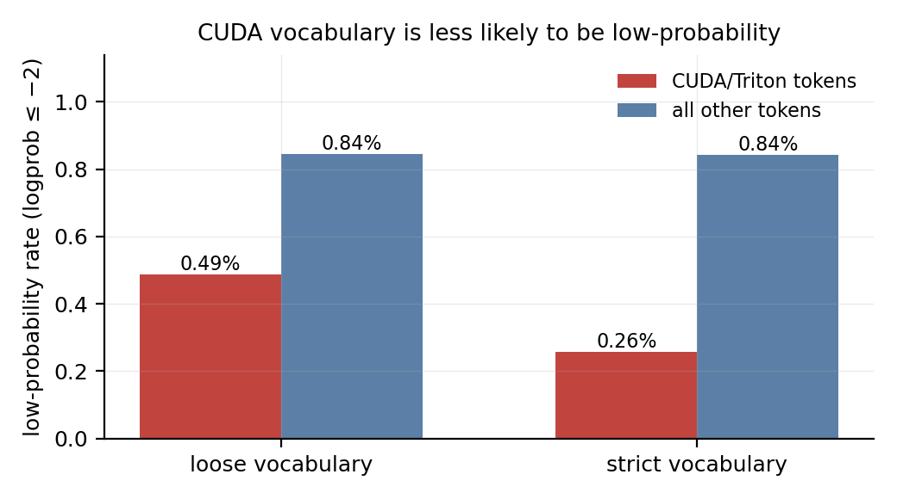
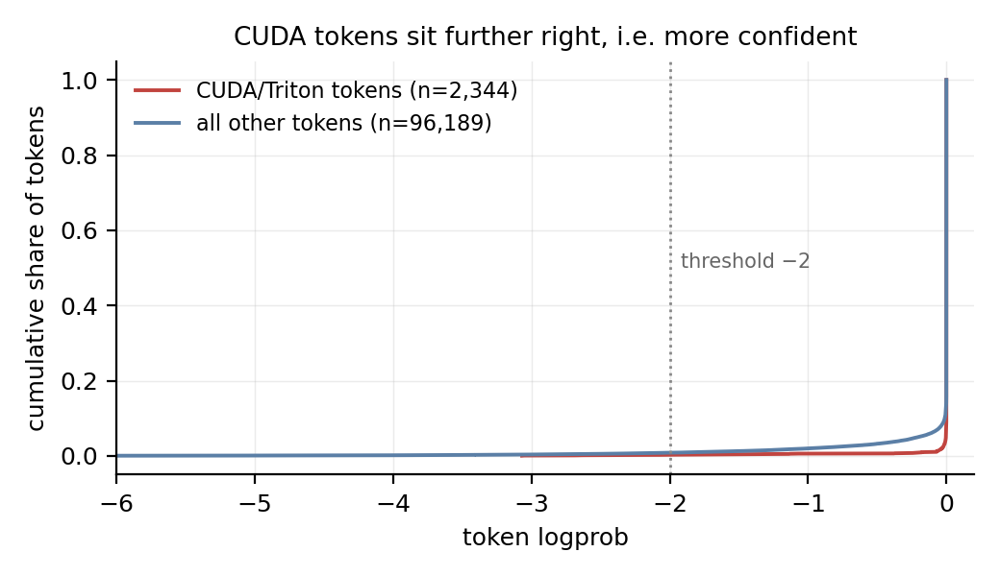
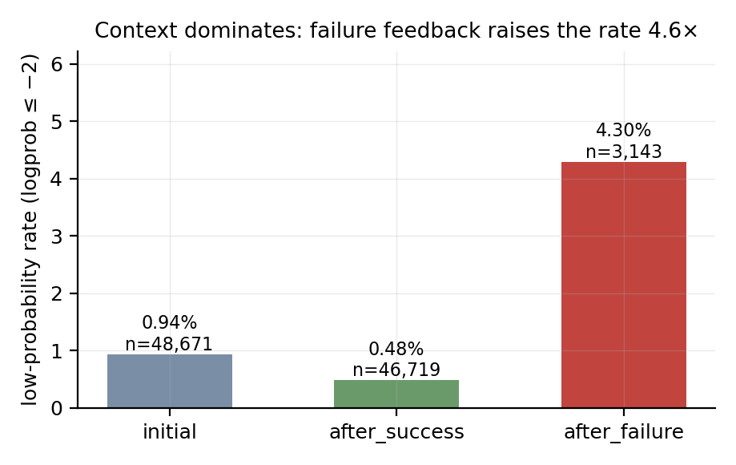
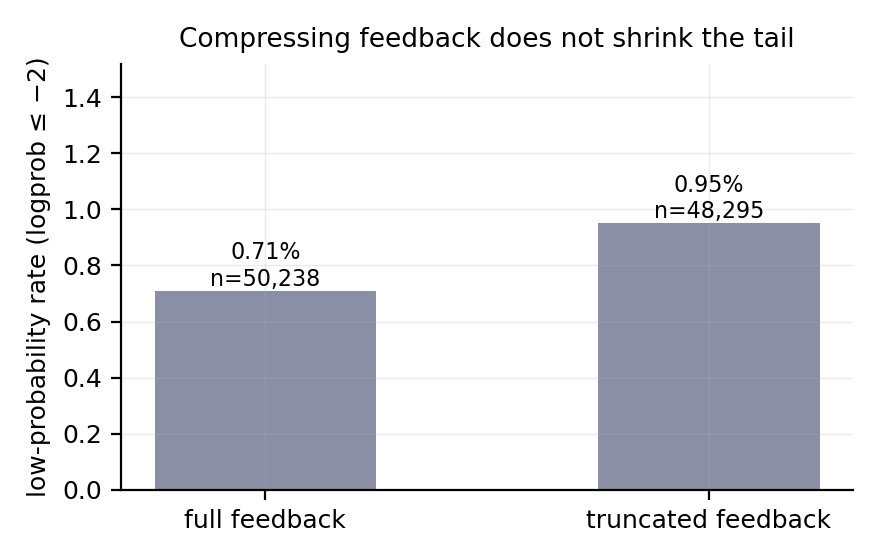
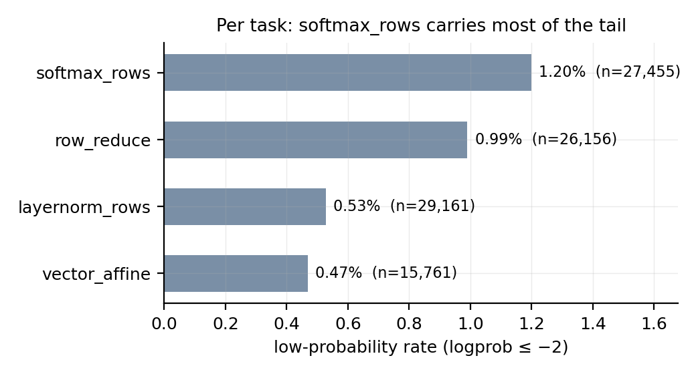

# Is CUDA Syntax Rare Enough to Break PPO? A Conditional-Probability Test of a Stated Root Cause

**Author:** leo-grayrat
**Affiliation:** Independent research
**Date:** 2026-10-17

---

## Abstract

CUDA Agent attributes its policy collapse at training step 17 to a specific chain: CUDA code is under 0.01% of pretraining data, the base model therefore assigns near-floor probability to CUDA tokens ($\pi_\theta(a_t \mid s_t) \approx 10^{-9}$), and small train/inference precision differences are amplified into exploding importance ratios. The first link of that chain — that CUDA vocabulary constitutes a low-probability tail at generation time — has not been tested independently, partly because closed APIs do not expose logprobs for tool-call arguments. We measure it directly. Leaving the agent framework behind, we drive multi-turn chat in which the kernel is written in the reply body, so every code token falls under `logprobs`. Over 128 runs (4 Triton tasks × 2 feedback conditions × 16 repeats) we obtain 98,533 content tokens with conditional probabilities. Three findings. First, CUDA/Triton vocabulary is **less** likely to be low-probability than everything else: 0.26% versus 0.84% under a strict boundary (Fisher $p = 0.0007$) and 0.49% versus 0.84% under a loose one ($p = 0.0070$), with both boundaries agreeing in direction. Second, context dominates token identity by an order of magnitude — tokens emitted after a failed evaluation carry a 4.30% rate against 0.94% at the first turn. Third, compressing the environment feedback does not reduce the tail (0.71% versus 0.95%), so the planned intervention is inert. We do not read the nine-order-of-magnitude gap between $\approx 10^{-9}$ and our measured $\approx 1.0$ as a refutation, because the two measurements differ in model state (un-finetuned base model during rollout versus an aligned model at inference). What the data do establish is a tension the original narrative must resolve, and a concrete control — repeating the measurement on a base model — that would resolve it.

**Keywords:** CUDA Agent; training instability; log-probability; out-of-distribution context; Triton

---

## 1. Introduction

### 1.1 A causal chain that begins with a lexical claim

Agentic reinforcement learning now produces GPU kernels that beat compiler autotuning. CUDA Agent reports pass rates of 100%, 100% and 92% across the three KernelBench difficulty splits and faster-than-`torch.compile` rates of 97%, 97% and 92% [@cudaagent, Tab. 2]. The system places a language model inside a real development sandbox — compile, verify, profile, iterate — and optimises a policy over multi-turn trajectories with PPO. Its published account of the training recipe is unusually specific about one failure and one fix: the first run "could only train stably for 17 steps before the model's performance collapsed", and stability to 150 steps came from warming up the actor by rejection fine-tuning and the critic by value pretraining [@cudaagent, Sec. 5].

The stated cause of the collapse is lexical. The paper writes that CUDA coding data "accounts for less than 0.01% of pretraining data", producing a "severe domain distribution mismatch"; the policy is said to place mass on very rare token sequences "sometimes at probabilities near the numerical floor, e.g. $\pi_\theta(a_t \mid s_t) \approx 10^{-9}$", so that "even small train-rollout precision differences can explode the importance ratio $\rho_t(\theta) = \pi_\theta(a_t \mid s_t) / \pi_{\theta_{old}}(a_t \mid s_t)$" [@cudaagent, Sec. 5.1–5.2; @cudaagentblog]. The remedy — three-stage warm-up — is then justified as moving the policy away from "the worst part of the distribution gap" [@cudaagentblog].

That argument has a testable first link. Everything downstream (precision amplification, ratio explosion, warm-up necessity) presumes that CUDA vocabulary is, in fact, sampled at near-floor probability. If CUDA tokens instead carry probabilities near 1, the chain does not start, and whatever does destabilise training must be sought elsewhere. This paper tests that link directly, by measuring the conditional probability of each emitted token under a real multi-turn kernel-writing loop.

### 1.2 Why the lexical claim is doubtful a priori

Four observations make the premise worth challenging before any measurement.

*First, most tokens in CUDA code are not CUDA-specific.* A kernel is dominated by `for`, `if`, `float`, `int`, brackets, operators and identifiers — all drawn from distributions that general code pretraining covers densely. The vocabulary that is uniquely CUDA — `threadIdx`, `__shared__`, `__syncthreads()`, `tl.load`, `tl.atomic_add` — is a small and, crucially, *highly templated* subset. These tokens occur in stereotyped contexts where the continuation is nearly deterministic: after `tl.` the model has a small set of plausible members, and after `@triton.jit` followed by `def`, the next tokens are almost fixed.

*Second, the quantity that governs sampling is conditional, not marginal.* $\pi_\theta(a_t \mid s_t)$ depends on the context $s_t$; a 0.01% marginal share in pretraining says nothing about the conditional probability at a specific position in a specific kernel. A token can be rare in the corpus and highly predictable in context.

*Third, the source's own results contradict "the model cannot write CUDA".* The base model Seed 1.6 passes 74% of KernelBench overall and 90% at Level 1 [@cudaagent, Tab. 2]. A model that passes 90% of Level 1 problems does not have near-zero probability mass on CUDA syntax; what it lacks is the ability to produce *fast* kernels — only 27.2% of its outputs are faster than `torch.compile`.

*Fourth, an equally good explanation is available.* Independent work on Triton kernel RL, DR. KERNEL, treats the same instability as a training–inference mismatch, stabilises it with geometric mismatch rejection sampling plus a token-level veto, and reports that stabilisation does not lift the performance ceiling [@drkernel]. Mismatch between rollout and training engines is a property of the *context distribution* being off-policy, not of the token vocabulary being rare. Liu et al. analyse the same drift [@liuoffpolicy].

### 1.3 What this paper does

We measure per-token conditional probabilities inside a real multi-turn kernel-writing loop and ask three questions:

- **RQ1** — Is CUDA/Triton vocabulary more likely to be low-probability than other tokens?
- **RQ2** — Does the low-probability rate vary with context type; if so, which context carries it?
- **RQ3** — Does compressing the environment feedback reduce the rate?

The measurement requires solving a practical obstacle first. Under an agent framework the kernel is written through tool calls, and tool-call arguments are not covered by `logprobs` — a vendor policy choice, not a technical limit (§2.4). We therefore remove the tools: the model is asked to write the kernel in its reply body, and a driver on our side writes the file and runs the evaluator. This keeps the model's natural behaviour while making the measurement exist. A pre-flight check confirms 448 of 448 code tokens inside the reply carry a logprob.

### 1.4 Findings in brief

Over 128 runs and 98,533 content tokens: CUDA vocabulary is *less* likely to be low-probability than other tokens (0.26% vs 0.84%, $p = 0.0007$); context dominates, with failure feedback at 4.30% against 0.94% for the first turn; and compressing feedback leaves the rate unchanged. The lowest-probability tokens in the entire corpus are ordinary English words, never code. The evidence supports the *alternative* explanation in the literature — that instability tracks context, not vocabulary — and leaves the original causal chain without its first link.

### 1.5 Significance and scope

If the first link fails, "add more CUDA data" is aimed at the wrong target. The data instead point at what happens *after a failed evaluation*, where the context leaves the training distribution in a way that has nothing to do with which words are rare.

Scope, stated up front: we measure an aligned commercial model at inference, not the un-finetuned base model during rollout. That difference is material and is treated at length in §5.2; it is the reason this paper reports a tension rather than a refutation.

---

## 2. Related Work

### 2.1 The causal chain under test

CUDA Agent's mechanism has four links: (i) CUDA is under 0.01% of pretraining; (ii) the resulting domain mismatch yields "numerous sampled low-probability CUDA kernel code tokens"; (iii) near the precision floor ($\pi_\theta \approx 10^{-9}$), BF16-versus-FP16 differences produce large importance-ratio variance; (iv) the ratio explodes and training collapses [@cudaagent, Sec. 5.1]. The remedy is three-stage warm-up: single-turn RL, then rejection fine-tuning of the actor on positive-reward trajectories, then value pretraining of the critic with GAE targets ($\gamma = 1$, $\lambda = 0.95$), after which multi-turn PPO runs with asymmetric clipping ($\varepsilon_{lower} = 0.2$, $\varepsilon_{higher} = 0.28$) for 150 steps [@cudaagent; @cudaagentblog].

Link (ii) is the one this paper measures. Links (iii) and (iv) require training and are out of scope.

### 2.2 DR. KERNEL: the same instability, a different attribution

DR. KERNEL studies RL for Triton kernel generation and reaches the instability from a different angle [@drkernel]. It states two hypotheses: that saturation stems from training instability caused by training–inference mismatch, and that the objective is misaligned with meaningful speedup. For the first, it monitors entropy, gradient norms and perplexity, finds "excessively high values across these metrics", and applies geometric Mismatch Rejection Sampling — retaining samples only when the geometric-mean importance ratio $w = \exp(\frac{1}{|T|}\sum_t \log \frac{\pi_{train}(a_t|s_t)}{\pi_{rollout}(a_t|s_t)})$ lies in $[0.999, 1.001]$ — plus a token-level veto that rejects an entire sequence if any single token's likelihood ratio falls below $10^{-4}$ [@drkernel, Sec. 5.1].

The finding that matters here is negative and precise: MRS "successfully stabilizes the training dynamics", but "it does not fundamentally lift the performance ceiling" [@drkernel, Sec. 5.1]. Instability is therefore attributable to a *distributional* discrepancy between the two engines, and correcting it is necessary but not sufficient. Note what this framing does *not* require: no claim about token rarity. The unit of the problem is the trajectory's context, not the vocabulary.

### 2.3 Precision mismatch and off-policy drift

The mechanisms cited by CUDA Agent form a family. Jet-RL, *Precision Mismatch in Reasoning Models* and *First-Order Approximation for Stable LLM-RL Training* all concern the sensitivity of the PPO ratio when probabilities sit near the numerical floor; once $\pi_\theta$ is at $10^{-9}$, a small absolute difference is a large relative one [@cudaagent; @cudaagentblog]. Liu et al. characterise the complementary phenomenon, where the efficiency machinery of an RL framework makes training data off-policy [@liuoffpolicy].

These papers assume the floor condition. Our contribution is to check whether it holds at generation time for the domain in question — a precondition rather than a competing mechanism.

### 2.4 Why closed APIs cannot answer this

Measuring per-token conditional probabilities requires `logprobs`, and for tool calls the field is withheld. The pattern is consistent across vendors and has been stable for years. On the OpenAI forum, a 2024 thread reports that with `functions` set, `logprobs=True, top_logprobs=5` returns `ChoiceLogprobs(content=None)`, and that removing the function restores it; the forum reply attributes this to not wanting "the AI method of sending to a tool recipient revealed". Follow-ups in 2024-03, 2025-06 and 2025-07 received no official answer, and the capability remains absent.

A 19-model survey finds three behaviours: reasoning models reject the parameter outright (`"logprobs are not supported with reasoning models"`); Claude, Gemini, Grok and others accept it and silently return none; and several reasoning models spend the token budget in the reasoning channel and return empty content, which is the same trap we hit ourselves (§3.6). Three papers that examine closed models as scientific instruments converge on the same obstacle. *How Open Must Language Models be* names an "Information Restriction Problem" — APIs return only final text, hiding the probability distribution — and judges closed models "generally unfit for rigorous scientific inference". *Surrogate Fidelity* opens by noting that APIs "at best expose log-probabilities over output tokens". *Log Probability Tracking of LLM APIs* is reviewed with the limitation stated plainly: "Most providers do not provide logprobs as these can be used to exfiltrate model details", citing Carlini et al. on recovering model properties from output distributions.

The practical consequence is architectural: an agent-framework experiment cannot measure the tokens that matter, so the framework has to go (§3.1).

### 2.5 Position of this work

The works above study instability from the training side, through interventions and monitored training dynamics. This paper does not train. It measures the generation-time probability distribution that the causal chain's first link asserts, on a model whose weights we do not control but whose outputs we can read.

---

## 3. Method

### 3.1 Removing the framework so the measurement exists

An agent writes the kernel through `write` or `edit` tool calls; the kernel text lives in the tool arguments; tool-argument tokens carry no logprob (§2.4). Two workarounds fail. Asking the model, via prompt suffix, to first print the code in its reply and then call the tool was tried and produced compliance in 0 of 6 trials — the model's natural policy is to act, not to narrate the action. Replaying saved conversations against the API afterwards cannot recover $\pi_\theta(a_t \mid s_t)$ either, because the chat template and special tokens applied at generation are not reproducible from a plain reconstruction, so the probabilities would not be the ones that produced the trajectory.

We therefore remove the tools. The driver sends a task description plus `reference.py` and asks for the complete `candidate.py` inside a fenced block, with no tools offered. The model writes code in `message.content`; that field is covered by `logprobs`. The driver then parses the block, writes the file, invokes the independent evaluator, and appends the evaluator's output as the next user turn.

This is the design decision the whole study rests on, so we verified it before collecting: a single-turn probe returned a 1,396-character code block containing `@triton.jit` and `tl.load`, with 448 of 448 tokens inside that block carrying a logprob.

### 3.2 The loop

Formally, at turn $t$ the driver holds a message list $M_t$. It requests completions with `logprobs=true, top_logprobs=20, temperature=1.0`, receiving a completion $y_t$ and, for each token, $\log \pi_\theta(y_{t,i} \mid M_t, y_{t,<i})$. It extracts the fenced block, stages it as `candidate.py` in an isolated temporary directory together with `reference.py` and the evaluator, runs the evaluator, and constructs feedback $f_t$. Then

$$M_{t+1} = M_t \oplus [\text{assistant}: y_t] \oplus [\text{user}: f_t]$$

The loop terminates when the evaluator reports correctness after at least one revision, when no fenced block is produced, or at a turn cap of 8.

### 3.3 Tasks

Four Triton tasks, two from the regular set and two held out:

| Task | Computation | Character |
|---|---|---|
| `row_reduce` | row-wise sum of a contiguous float32 matrix | pure reduction |
| `vector_affine` | $x \mapsto 1.75x + 0.25$ elementwise | memory-bound |
| `layernorm_rows` | row-wise mean/variance normalisation | two-pass reduction |
| `softmax_rows` | row-wise softmax | max-subtraction plus reduction |

`row_reduce` and `vector_affine` were visible during development; `layernorm_rows` and `softmax_rows` were held out and never used to tune anything.

Each task ships a `task.md`, a `reference.py` (the PyTorch computation), a `candidate.py` stub, and an `evaluate.py` that runs the candidate in a fresh directory, checks correctness against the reference on three shapes at tolerance $10^{-4}$, and times it. The evaluator is never visible to the model.

### 3.4 Feedback conditions

We implemented the intervention the plan specified, before seeing any data:

- **full** — the evaluator's verbatim output: compile errors in full, mismatch details, timing.
- **truncated** — one line: `compilation failed`, `output mismatch`, or `correct`.

The pair is designed to separate *how much* the model learns from a failure from *that* a failure occurred. If the tail were caused by long diagnostic text, truncation would shrink it.

### 3.5 Token classification, and why two boundaries

Token types are assigned by matching keyword tables against **every** content token in the stream, with leading `.`/`@` stripped. No segment information is used. Two vocabularies are applied:

- **loose** — 28 Triton API names and modifiers (`tl`, `load`, `store`, `zeros`, `arange`, `atomic_add`, `num_warps`, `program_id`, …).
- **strict** — only unambiguous spellings (`tl`, `num_warps`, `num_stages`, `constexpr`, `program_id`) plus CUDA-native identifiers (`threadIdx`, `__shared__`, `__syncthreads`, …).

A result is reported as established only if both boundaries agree. This rule exists because an earlier iteration failed it (§5.5).

### 3.6 Model selection, settled empirically

The API offers reasoning and non-reasoning models. Under a reasoning model the token budget was consumed inside the reasoning channel, `finish_reason` came back as `length`, and `content` was empty: at `max_tokens=4000` the probe produced 14,042 characters of reasoning and zero characters of code; at 16,000 it finally produced content. The non-reasoning model places everything in `content`, reports zero reasoning tokens, and solved `row_reduce` in two turns in 22 seconds.

All reported runs use the non-reasoning model with `max_tokens=8192`.

### 3.7 Observables and statistics

The primary observable is the **low-probability rate** at threshold $\tau$:

$$R_\tau(G) = \frac{1}{|G|} \sum_{i \in G} \mathbb{1}\left[\log \pi_\theta(a_i \mid s_i) \le \tau\right]$$

with $\tau = -2$ as the headline. Group comparisons use Fisher's exact test (two-sided) on the $2 \times 2$ table of (low-probability, not) × (in group, not). Because the rate differences are large and the cell counts unbalanced, we prefer the exact test to a $\chi^2$ approximation.

Context type is assigned mechanically from the turn index and the previous evaluator verdict: `initial` for turn 0, `after_success` when the previous evaluation passed, `after_failure` when it failed.

### 3.8 Scale

4 tasks × 2 conditions × 16 repeats = 128 runs, of which 127 produced data (one run failed to emit a fenced block). All 127 finished with a correct kernel.

---

## 4. Results

### 4.1 RQ1: CUDA vocabulary is not the low-probability tail

Across 98,533 content tokens:

| Boundary | Group | $n$ | mean logprob | $R_{-2}$ | Fisher $p$ |
|---|---|---|---|---|---|
| loose | CUDA/Triton | 4,524 | −0.038 | **0.49%** | **0.0070** |
| loose | other | 94,009 | −0.062 | 0.84% | |
| strict | CUDA/Triton | 2,344 | −0.013 | **0.26%** | **0.0007** |
| strict | other | 96,189 | −0.062 | 0.84% | |

**Both boundaries agree in direction, and the direction is opposite to the hypothesis.** CUDA vocabulary is roughly one third as likely to be low-probability as the rest of the stream.



The distribution shifts, not just the rate. The cumulative distribution of logprob for CUDA tokens lies to the right of the rest (Fig. 3): CUDA tokens are more often saturated near $\log \pi = 0$ than other tokens are.



A third reference class sharpens the reading. Structural tokens — `for`, `if`, `def`, `return`, `in`, `not`, which have no alternative spelling at a given position — show $R_{-2} = 1.54\%$ against 0.81% for the remainder. So the axis that matters is not "CUDA versus not CUDA"; if anything, tokens with *no* choice are more likely to be low-probability than tokens with a domain-specific name.

### 4.2 RQ2: context dominates token identity

| Context | $n$ | mean logprob | $R_{-2}$ | p10 |
|---|---|---|---|---|
| **after_failure** | 3,143 | −0.276 | **4.30%** | −0.898 |
| after_success | 46,719 | −0.033 | 0.48% | −0.000 |
| initial | 48,671 | −0.074 | 0.94% | −0.049 |

The rate after a failed evaluation is 4.6× the first-turn rate and 9× the after-success rate. The gap between context types (4.30% vs 0.94%) is more than an order of magnitude larger than the gap between token types within any context.



The direction of the success case is informative on its own: `after_success` (0.48%) is *below* `initial` (0.94%). A passing evaluation narrows the space of plausible continuations — the model has seen its own code accepted and is revising within a known-good region.

### 4.3 RQ3: compressing feedback does nothing

| Condition | $n$ | $R_{-2}$ |
|---|---|---|
| full feedback | 50,238 | 0.71% |
| truncated feedback | 48,295 | 0.95% |

Truncation did not reduce the rate; the point estimate is slightly higher, well within noise for these counts. **The intervention is inert.**



This is a substantive negative result, not a failed manipulation check. Both conditions produced correct kernels at the same rate, so the model was not handicapped by the sparse feedback; what changed was only how much diagnostic detail it received. The tail is therefore attached to *the event of failing*, not to the length of the message describing the failure.

### 4.4 By task

| Task | $n$ | $R_{-2}$ |
|---|---|---|
| `layernorm_rows` | 29,161 | 0.53% |
| `vector_affine` | 15,761 | 0.47% |
| `row_reduce` | 26,156 | 0.99% |
| `softmax_rows` | 27,455 | 1.20% |



Task effects exist but are modest (0.47%–1.20%). The two held-out tasks sit at opposite ends, so this is not a leak from development.

### 4.5 Cross-model replication on a different stack

Before the API route, an earlier pass used an entirely different stack: a local vLLM server serving a 4-bit quantised 4B model, driven through an agent framework with a recording proxy. It covered `row_reduce` only, with 12 runs and 15,987 content tokens.

| Group | $n$ | $R_{-2}$ |
|---|---|---|
| CUDA/Triton API names | 451 | 1.55% |
| other | 15,536 | 0.95% |

Fisher $p = 0.211$ — **not significant**, but the direction matches the API pass. The value of this replication is robustness across stack differences: different model (4B quantised versus a commercial API model), different inference backend (local vLLM versus vendor API), different collection path (tool calls versus pure conversation). The direction survived all three.

That pass also produced finer-grained claims — quantile breakdowns, per-tool statistics, a position effect, and a proposed "API choice point" mechanism — which were subsequently withdrawn; see §5.5.

### 4.6 What the low-probability tokens actually are

The lowest-probability tokens in the corpus:

```
' constants'   −17.746   row_reduce      full       after_success
' backed'      −11.271   row_reduce      full       after_success
' small'       −10.725   softmax_rows    full       after_success
' computing'   −10.361   vector_affine   truncated  after_success
' wrong'       −10.056   softmax_rows    full       after_success
' weight'       −9.681   layernorm_rows  truncated  after_failure
```

**Not one is a code token; every one is an ordinary English word**, and most occur inside prose. The tail, such as it is, lives in the model's explanatory text rather than in the kernel it is writing.

---

## 5. Discussion

### 5.1 The stated root cause loses its first link

RQ1's answer is no, with the sign reversed. CUDA/Triton vocabulary carries a lower low-probability rate than the rest of the stream under both definitions, and the whole distribution is shifted toward confidence rather than away from it. The step "CUDA is rare in pretraining, therefore CUDA tokens are sampled at near-floor probability" does not hold at generation time in this setting.

The mechanism for why it does not hold is visible in the token inventory. `tl` appears seven times with logprob −0.000 every time; `.store` twelve times, all within 0.1 nat of zero. These are not rare words the model is guessing at; they are fixed parts of a template. The model knows what follows `tl.` in a Triton kernel. Rarity in a corpus and uncertainty at a position are different quantities, and here they point in opposite directions.

### 5.2 The nine-order-of-magnitude gap, and why it is a tension rather than a refutation

The source reports $\pi_\theta \approx 10^{-9}$; we measure $\approx 1.0$. A gap that large invites over-reading, and we explicitly decline it, because at least two conditions differ.

**Model state.** The source measures the un-finetuned base model during training rollouts. We measure an aligned commercial model through an inference API. Alignment — SFT followed by preference optimisation — raises the probability of common code patterns substantially; a kernel template that is near-floor for a base model can be near-certain for an aligned one. This is not a technicality: it is the difference between "the model has never been taught to write this" and "the model has been taught, and writes it fluently".

**Sampling conditions.** Training rollouts use whatever temperature, truncation and numerics the trainer sets; our requests use temperature 1.0 through the vendor API with its own default filtering.

The honest statement is therefore conditional: **under aligned-model inference, CUDA vocabulary does not form a low-probability tail.** That leaves the original narrative with something to explain. If the collapse at step 17 is caused by near-floor CUDA token probabilities, why does the phenomenon vanish in an aligned model writing the same kind of code? Either aligned models are immune — in which case the causal story is about base-model pretraining, not about CUDA — or the instability has a different source.

**The control that would settle it** is direct: repeat this measurement on a base model, before any fine-tuning. If CUDA token probabilities there are near the floor and rise after alignment, both accounts can be true and the chain is intact at the base-model stage. If they are not near the floor even before alignment, the chain fails at its first link. We could not run this control — it requires base-model weights — and it is the single highest-value follow-up.

### 5.3 What the data do support: context, and specifically failure

RQ2's effect is an order of magnitude larger than RQ1's, and it points at a different object. After a failed evaluation the low-probability rate is 4.30%, against 0.94% at the first turn. Failure feedback — compiler diagnostics, mismatch reports — is a text form that appears rarely in pretraining and is produced by the environment rather than by the model. The trajectory has moved off the distribution, and the next tokens are correspondingly less certain.

This reading agrees with DR. KERNEL's negative result [@drkernel]. There, correcting the train/inference mismatch stabilised training but did not raise the ceiling; here, the tokens that are genuinely uncertain are the ones emitted after the environment delivers bad news. Both point at the context of the trajectory rather than at the vocabulary of the domain.

The `after_success` figure supports the same reading from the other side: 0.48%, below the first turn. Acceptance is informative — it confirms the model is in a good region — and the model exploits that.

### 5.4 Why truncating feedback failed

RQ3 tested an intervention derived from a different theory: if long diagnostic text is what pushes the context off-distribution, short feedback should help. It did not (0.95% versus 0.71%, if anything slightly worse).

The result constrains the mechanism. It is not the *volume* of out-of-distribution text that matters, because truncating it to one line changed nothing. What matters is the *event*: the model has been told its kernel is wrong. The state, not the string, is what moves the distribution.

For practice this rules out an intervention that looked attractive on cost grounds — compressing tool output is a common efficiency measure — while suggesting that the productive direction is to change what the model is told or how it is asked to recover, not how briefly.

### 5.5 A methodological failure, kept because it explains the paper's design

The first pass produced a headline of `triton_specific` at a 10.00% low-probability rate with $p = 0.0156$. It was wrong, and the way it was wrong shaped this paper.

The classifier assigned token types using segment information: prose was treated differently from code, and three words — `load`, `zeros`, `store` — were deliberately excluded from the prose-side marker set to avoid misfiling English sentences such as "load the data". The consequence was that only occurrences of those words *inside code segments* could be labelled Triton-specific. That subgroup contained 20 tokens out of 451 total API-name occurrences — a 96% undercount — and those 20 happened to include two extreme samples, −2.634 and −2.371. The class rate was computed on that biased 20.

The same word, split by an artefact of the typing rule:

```
load labelled NL_reasoning      n=6   mean=−0.044  lowprob= 0.00%
load labelled triton_specific   n=4   mean=−1.034  lowprob=25.00%
```

**The between-group difference was manufactured by the classification rule itself.** Recomputing over all 451 occurrences moved $p$ from 0.0156 to 0.211.

Two rules came out of this and are applied throughout. Class statistics are computed by matching against every token, never against a pre-partitioned subset. And every headline number is reported under two deliberately different definitions, so that a result which holds only under one of them is visible as such.

### 5.6 Relation to the broader failure mode in this line of work

This project's earlier attempts at other questions failed in a characteristic way: an experiment was completed rigorously but measured a substituted object. One run replaced a real `SKILL.md` with a self-written prompt; another built synthetic credit-assignment baselines. The common shape is that the machinery was sound while the thing being measured had quietly changed.

This study's first pass is a variant of the same failure: the machinery was sound, the numbers were computed correctly, and the object being measured had been silently narrowed by a classification rule. The check that catches it is cheap — widen the definition and see whether the conclusion survives — and it was not run until the result looked surprising enough to warrant it.

---

## 6. Limitations

1. **Model state.** The measurement is on an aligned model at inference. The base-model control (§5.2) is missing and is the most important gap.
2. **Single model family.** All API runs use one model. The 4B replication (§4.5) is a different family but a weaker stack.
3. **Task scope.** Four tasks, all elementwise or reduction-shaped. Nothing with fusion, tiling, shared-memory staging, or launch-configuration search — the decision types where real optimisation lives. The vocabulary tested is therefore the *mechanical* part of CUDA, which is also the part most likely to be templated; a task whose kernel requires a non-obvious algorithmic choice might behave differently.
4. **Class imbalance in the key context.** `after_failure` is 3.2% of tokens (3,143 of 98,533). The 4.30% estimate rests on that sample.
5. **No training.** We do not measure whether low probability causes importance-ratio explosion, nor the relative contribution of precision mismatch. Both require training runs.
6. **One collection path.** All reported data come from a single driver against a single endpoint; cross-engine replication is absent.
7. **Evaluator feedback is text-based.** The model never sees a profiler; "performance" in this loop is correctness plus a timing line, so the `after_profiling` context the original plan anticipated does not occur.

---

## 7. Conclusion

The first link of CUDA Agent's causal chain does not hold under the conditions we can measure. CUDA/Triton vocabulary is *less* likely to be low-probability than the surrounding text — 0.26% versus 0.84% ($p = 0.0007$), with a second boundary agreeing — and the lowest-probability tokens in the corpus are ordinary English words rather than code.

What the data do show is that uncertainty tracks context. After a failed evaluation the rate is 4.30%, against 0.94% at the first turn and 0.48% after a success. Compressing the feedback does not help. The pattern matches the negative result reported by DR. KERNEL, where correcting train/inference mismatch stabilised training without raising the ceiling: the object that matters is the trajectory's distribution, not the domain's vocabulary.

The gap between the reported $\approx 10^{-9}$ and our $\approx 1.0$ is not offered as a refutation, because the two measurements differ in model state and sampling conditions. It is offered as a specific, resolvable tension, with the resolving experiment named: measure the same quantity on a base model. Until that is run, "CUDA is rare, therefore PPO explodes" remains a hypothesis whose first step has been tested once, on an aligned model, and failed.

---

## References

[@cudaagent] CUDA Agent: Large-Scale Agentic RL for High-Performance CUDA Kernel Generation. arXiv:2602.24286.

[@cudaagentblog] CUDA Agent: Agentic RL for High-Performance CUDA Kernel Generation. Technical blog, 2026-03.

[@drkernel] DR. KERNEL: Reinforcement Learning Done Right for Triton Kernel Generations. arXiv:2602.05885.

[@liuoffpolicy] Liu et al. Your Efficient RL Framework Secretly Brings You Off-Policy RL Training.

[@jetrl] Jet-RL: precision mismatch in RL training.

[@precisionmismatch] Precision Mismatch in Reasoning Models.

[@firstorder] First-Order Approximation for Stable LLM-RL Training.

[@carlini] Carlini et al. Stealing Part of a Production Language Model.

[@howopen] How Open Must Language Models be to Enable Reliable Scientific Inference? (2026).

[@surrogate] Surrogate Fidelity: When Can Open LLMs Explain Closed Ones? (Meta).

[@logprobtracking] Log Probability Tracking of LLM APIs. INRIA, OpenReview.

---

## Appendix A — Reproducibility

```bash
# Pre-flight: does the reply body carry logprobs for code?
python scripts/check_plaintext_logprobs.py --model deepseek-chat --max-tokens 16000

# Collection
python scripts/loop_driver.py \
    --tasks row_reduce vector_affine \
    --conditions full truncated --repeats 16 --max-turns 8 \
    --model deepseek-chat --max-tokens 8192 \
    --runs-root lowprob-attribution/runs-formal
python scripts/loop_driver.py \
    --heldout --tasks layernorm_rows softmax_rows \
    --conditions full truncated --repeats 16 --max-turns 8 \
    --model deepseek-chat --max-tokens 8192 \
    --runs-root lowprob-attribution/runs-formal

# Analysis and figures
python scripts/analyze_loop.py lowprob-attribution/runs-formal
python scripts/make_figures.py
```

Raw records: `runs-formal/<task>-<condition>-<NN>/` containing `turns.jsonl` (per-turn content, reasoning, and the full logprob array), `transcript.json`, and `final_candidate.py`.

Two implementation notes that cost time: the evaluator takes the candidate **file** as `argv[@cudaagent]`, not the directory (it hashes the file directly); and the evaluator needs an interpreter with `torch`, which the driver's own runtime does not have, so the two run under different Pythons.

## Appendix B — Production record

Produced with an AI assistant. The experiment, analysis, and manuscript were built in one session; `PROCESS.md` records the full trajectory including the retracted first pass, the engineering obstacles (proxy interception, skill-loading contention, reasoning-budget exhaustion, a blocking subprocess probe, a WSL distribution installed on the wrong volume), and the user interventions that redirected the work — in particular the observation that "API choice point" is not specific to CUDA, which is what led to discovering the classification bias of §5.5.
