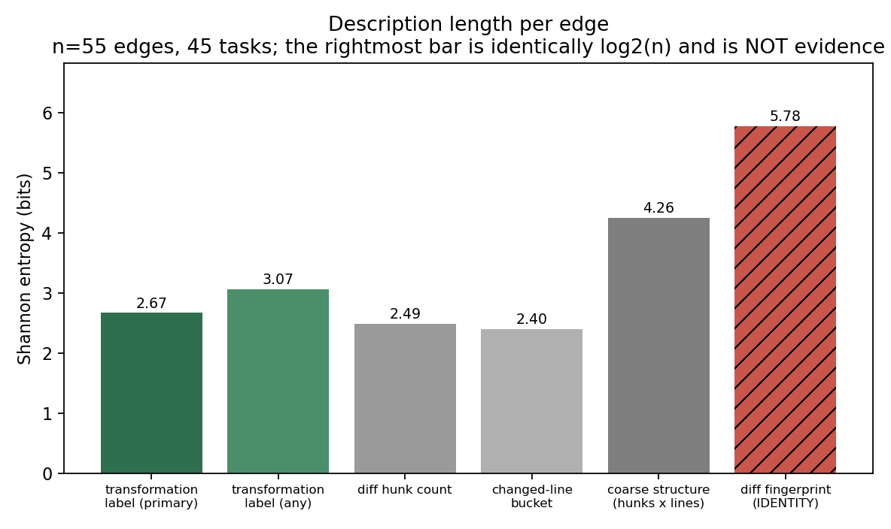
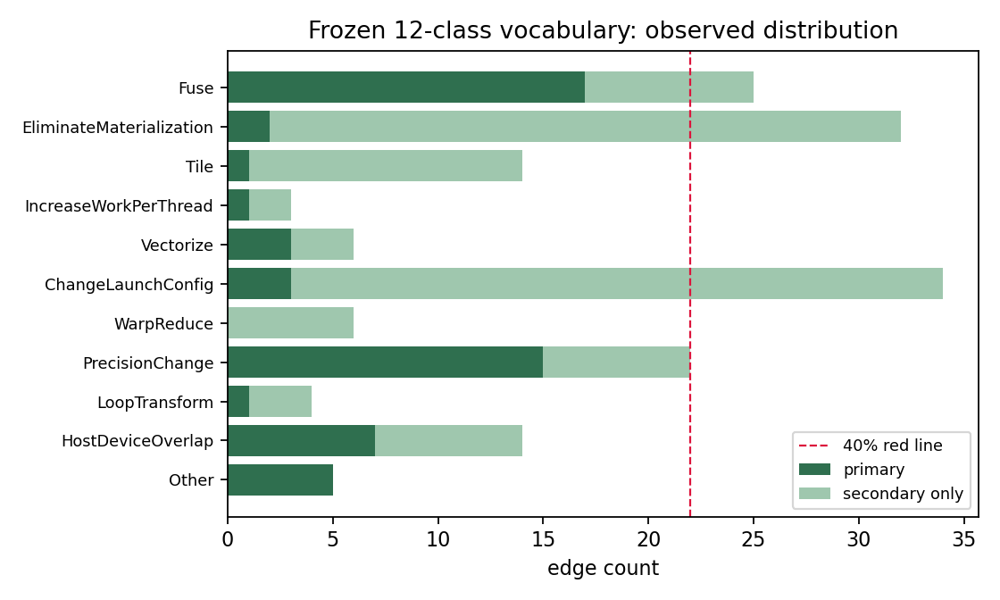
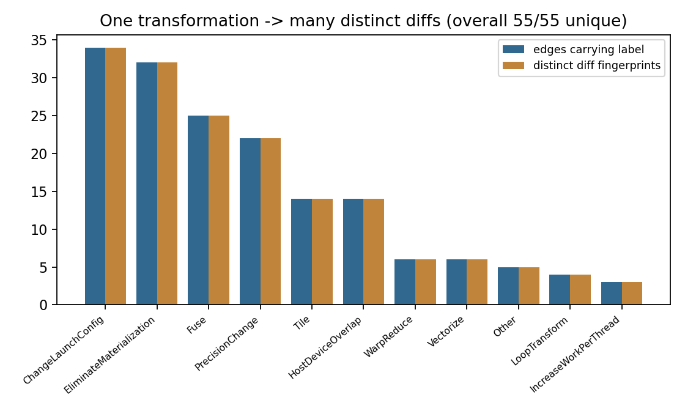
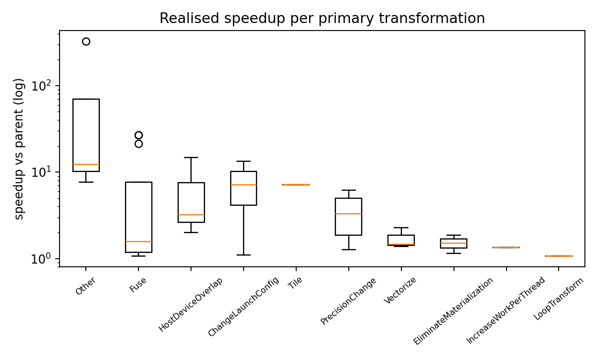
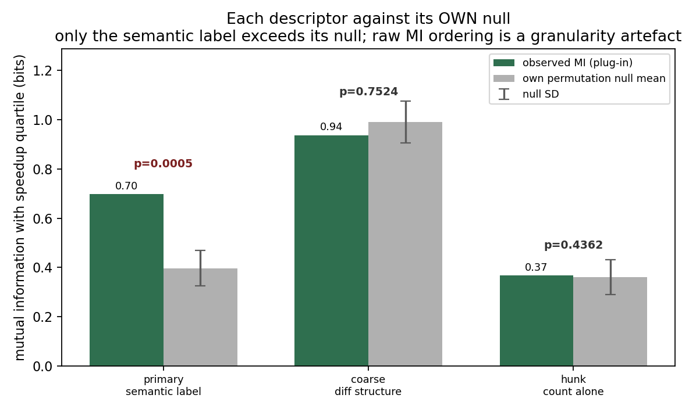

# Is Token-Level the Wrong Coordinate System? Program Transformation as the Action Space for LLM-Driven Kernel Optimization

**Position and analysis paper.** Draft: Stage 4 (v2, revised after five-reviewer simulated peer review; revision log in
`stage4_revision/REVISION_NOTES.md`). All analysis numbers in Section 3 are computed from public data and are
reproducible from the accompanying scripts; Section 3.6 reports a statistical error found in v1 by that review.

---

## Abstract

Agentic reinforcement-learning systems now write GPU kernels that beat compiler autotuning. They update a policy
over sampled text and attach one execution-level reward at the end of thousands of decisions. Performance, however,
belongs to a handful of program design decisions — fuse two passes, stop materializing an intermediate, change the
per-thread workload — each realized across many tokens and several separated code sites. We ask whether this is the
wrong *coordinate system*: the action unit. We formalize a candidate action as a typed program transformation `a = (τ, ℓ, θ)`, and separate three claims the literature
conflates: description, search efficiency, learning efficiency. On public AdaExplore trajectories (2,510 successful
parent→child edges; 55 annotated over 45 tasks) a frozen 12-category vocabulary covers 90.9% of edges using 10
categories, and under symmetric permutation calibration the semantic label predicts realised speedup beyond its own
granularity (p = 0.0005) while coarse diff structure (p = 0.752) and hunk count (p = 0.436) do not. Three
qualifications are reported rather than buried: two supporting statistics are withdrawn as an identity and a
sampling artefact (our 117-assertion harness missed the error that reversed this headline); cross-task recurrence
sits at chance; and relabelling without the category definitions leaves the headline insignificant (p = 0.106,
kappa = 0.687). K-Search, CuAsmRL, CodeAct and CUDA Agent's own skill checklist already occupy parts of the
proposed interface, narrowing our contribution to measurement and protocol. Search and learning stay untested; we
specify the five-condition experiment that decides them, including the branch that kills the direction.

*(250 words, measured by `scripts/audit_spec_coverage.py`)*

---

## 1. Introduction

### 1.1 The empirical fact that motivates the question

Modern agentic reinforcement-learning systems can now write GPU kernels that beat compiler autotuning.
CUDA Agent reports 100%, 100%, and 92% faster-than-`torch.compile` rates on the three KernelBench difficulty
splits, outperforming the strongest proprietary models by about 40% on the hardest split [1,2]. It reaches there by
placing a language model inside a real development sandbox — compile, verify correctness, profile, iterate — and
optimizing a policy over long multi-turn agent trajectories with PPO, at a context length of order 10⁵ tokens [1].
The released artifacts are a 6,000-sample operation dataset, a skill specification, and the reward and warm-up
training recipe; the model weights, agent trajectories, and training-time observables are not public [1,3].

Read at the level of the abstract and the released recipe, the training-side machinery is a chain of generally
motivated fixes: warm the model up on shorter episodes before asking it to run long ones; supervise-fine-tune on
successful trajectories before reinforcement learning; pretrain a critic offline; bound the reward so that
outcome-based scoring does not over-reward tasks with large headroom; constrain the policy update range to keep
stability. Each step is a sensible response to a symptom of the training substrate. None of them, *as described in
the material we could verify*, is forced by memory hierarchies, warp semantics, coalescing, or shared-memory bank
conflicts.

Two qualifications are necessary, and the first one is not a hedge we chose but a distinction the system itself
makes.

* **That paper uses "action" for two different things at two different layers, and we must say which one we are
  attacking.** In its reinforcement-learning formulation the action is explicitly the token: its clipped PPO
  objective defines $a_t$ as "the action (i.e., token) taken at position $t$" [1, Sec. 5.2]. But its environment
  is separately described in these terms: a toolset of Bash, Read/Write, Edit/MultiEdit, Glob, Grep,
  NotebookEdit, BashOutput and KillBash, where "*these tools define the action space of the agent* and serve as the
  only mechanisms through which it can interact with the system" [1, App. "Details of Agent Loop"], with MultiEdit
  characterised as applying "multiple atomic edits within one file". So the claim "CUDA Agent treats each token as
  an independent action" is true of its credit-bearing layer and false of its interface layer, where the unit is
  already an edit-sized operation. That is precisely the ambiguity this paper is about: the same system carries two
  candidate coordinate systems, and the training machinery is attached to the finer one. Our question is which layer
  should carry the learning signal, not whether anyone has ever used a coarse action.
* **The transfer argument must not be over-read.** NKI-Agent adapts the CUDA-Agent framework to AWS Trainium and
  reports that GRPO with a binary compilation reward *fails to improve on supervised fine-tuning* [18]. That is a
  failed transfer of the reinforcement-learning component, not a successful transfer of the recipe, and citing it
  as evidence that "the recipe moves untouched" would be self-contradictory. What it does support is narrower and
  still uncomfortable for the field: the training recipe is under-specified enough that reproducing it on new
  hardware changes which parts survive, and the reinforcement-learning part is not the portable core.

Unlike our earlier draft, we are not arguing from the abstract alone. The arXiv LaTeX source of [1] is retrievable
as an 18 MB e-print bundle and we read it, so the design choices we call generic can be quoted rather than
characterised: the reward is a four-level quantised function $r \in \{-1, 1, 2, 3\}$ keyed to correctness and to a
>5% margin over the eager and `torch.compile` baselines, explicitly because "operators vary substantially in
optimization difficulty, making raw speedup an unreliable proxy for code quality"; the PPO clip is asymmetric with
$\varepsilon_{\text{lower}} = 0.2$ and $\varepsilon_{\text{higher}} = 0.28$; the initial trial "could only train
stably for 17 steps before the model's performance collapsed", reaching 200 after the warm-up stages; and the stated
root cause is a "severe domain distribution mismatch", because "CUDA coding data accounts for less than 0.01% of
pretraining data", with low-probability tokens near $\pi_\theta \approx 10^{-9}$ amplifying train/inference
numerical-precision differences into importance-ratio variance [1, Sec. 5.1-5.2].

Every one of those five mechanisms is a response to a symptom of training a long-horizon policy on rare text under
a sparse outcome. None of them is derived from a property of GPUs. Note also that the source is candid that the
quantised reward exists to stop easy kernels from dominating selection — the same concern we raise independently in
Section 5.5 about scoring candidates by raw measured speedup.

So the honest question is not whether the result is impressive — it is — but what the *incremental scientific
claim* is, and whether the modelling choices are contingent on the domain or merely on the training substrate.

### 1.2 The black hole in the middle

There is a structural gap between how these systems learn and what they are being asked to produce. Performance is
an *executed, structural* property. A jump from 1.0× to 1.8× may be attributable to one design decision — fuse two
passes and eliminate one global-memory round trip — while the other two thousand tokens are boilerplate that
would have been written nearly identically anyway. The training interface, though, is a per-token policy update.
Nothing in the pipeline tells the learner "the decision at step 1,537 is the one that paid". Value functions and
GAE estimate credit *statistically* over token sequences.

This gap is not unnoticed in the literature; it is now its own research area. A recent survey synthesises a 69-paper
corpus of credit-assignment methods for LLM reinforcement learning organised precisely by *granularity* — trajectory,
segment, step, token — and reports that sparse outcome rewards "say little about which token, reasoning step, tool
call, memory operation, or agent caused an outcome" [35]. Current practice therefore already intervenes below the
trajectory: process rewards, span-level advantage reweighting, turn-level verifiable supervision, counterfactual
token credit. Our claim is not that credit is unaddressed. It is a different claim: almost all of that work changes
the **credit target** while leaving the **action unit** at the token, so the learner still treats a single program
decision as hundreds of separate actions whose joint realization it must discover statistically. Reweighting the
token-level credit and re-typing the action unit are orthogonal remedies, and the second is the one that would remove
the need for the first.

The standard response is better credit assignment: find the important spans, reweight them, sharpen the critic.
Our previous work attempted exactly this with regex-based source locators and oracle-labelled spans, and it failed
in an instructive way. A single optimization decision can be spread over a kernel body, an index computation, a
shared-memory declaration, and host-side launch parameters; conversely, the same decision can be realized by
completely different code. Locators keep missing things because they are trying to recover a *program decision
unit* out of *textual locality*, and the two are not in one-to-one correspondence.

That failure is what pushes the question one level up.

### 1.3 The reframing

Why should the training system treat forty tokens as forty actions in the first place? They are one implementation
of one program decision. The question therefore stops being "on which tokens should the reward land" and becomes:

> **Is the token-level action space itself the wrong coordinate system for LLM-driven kernel optimization?**

Concretely: does CUDA optimization admit a natural action space that is more stable and more transferable than
tokens, and would moving the search and learning interface onto it measurably change search efficiency and learning
efficiency?

We write the candidate action as

```
a = (τ, ℓ, θ)
```

transformation *type*, *location*, *parameters*. The load-bearing structure is a many-to-many relation:

```
one semantic action   →  many tokens, many code sites
very different code   →  the same semantic action
```

Consider increasing per-thread workload from one element to two. In CUDA C++ this requires a new index expression
in the kernel body (`int j = i + stride; if (j < n) ...`) *and* a host-side change of the block count from
`N/T` to `N/(2T)`. The two edits are far apart in the file and neither one alone constitutes the action. That is
the shape of the object we mean.

### 1.4 What would count, and what this paper actually claims

There is a trivial version of this idea that has no research value: "compiler passes are more semantic than tokens"
is a fact that compiler people have known for decades, and Halide, TVM, and Ansor already put schedule
transformations at the centre of their search spaces [8,9,10]. If our conclusion were only that, we would have
rediscovered IR.

The non-trivial claim is specific to LLM-in-the-loop optimization:

> Moving the interface from *generate the whole program* to *select a parameterized transformation, then realize
> it* measurably changes search efficiency and learning efficiency.

And it has a prerequisite that must be checked before any of that is worth building:

> **Can real successful kernel-optimization trajectories be explained by a small set of recurring program
> transformations?**

If every successful child is a one-off rewrite that cannot be grouped into a stable vocabulary, the direction is
dead and no amount of infrastructure fixes that. If, instead, edges keep landing on recurring patterns — increase
work per thread, eliminate an intermediate, merge kernels, retile shared memory, change reduction structure — and
the same pattern shows up with very different code, then we get the phenomenon worth studying: **high diff entropy,
lower transformation entropy**. That would be data forcing us to admit a structure more natural than tokens, not
us inventing an abstraction to publish.

This paper does three things:

1. **States the thesis precisely and separates claims that are routinely conflated** (Section 2): the
   *descriptive* claim that transformations are a stable description unit, the *search* claim that they change
   search efficiency, and the *learning* claim that they change learning efficiency. The first is necessary but in
   no way sufficient for the other two. It also separates the transformation cut from the neighbouring *turn-level*
   and *edit-level* cuts, both of which already exist in the literature [30,32].
2. **Reports a calibrated measurement study on public trajectories** (Section 3). The descriptive claim survives a
   symmetric permutation test; the transferability claim does not survive its own null.
3. **Specifies a falsifiable experimental framework** (Section 4): five conditions including an enumeration-plus-cost-model
   arm, and a reading tree under which each possible pattern of results implies a specific, pre-committed conclusion —
   including patterns that kill the direction outright. Since the protocol is not novel as a *system* — K-Search has
   already realized its structured-action condition with positive results [29] — its value is as an instrument for
   *independently falsifying* that class of result rather than as a proposal to be first.

### 1.5 Provenance and honesty statement

This is a position-and-analysis contribution: a thesis, preliminary observational evidence, and a protocol design.
It contains **no training experiments, no new algorithm, and no search experiments**. It is produced by an
automated research pipeline; the annotations that generate Section 3 are machine-produced, not human, and the
circularity that creates is stated in Section 7. We consider the negative and self-undermining results in
Sections 3.6 and 3.7 to be the most valuable part of this paper, and we have kept them rather than removing them.

---

## 2. Position: The Wrong Coordinate System

### 2.1 Three levels at which a training interface can be cut

Any optimization loop over programs must decide what counts as one action. Three cuts are natural.

| Cut | Action unit | Credit lands on | Failure mode |
|-----|-------------|-----------------|--------------|
| Token | one sampled token | GAE/value estimates over ~10³–10⁴ steps | decision unit invisible; credit is statistical guesswork |
| Edit span / code block | a contiguous diff region | the span | decisions are *not* contiguous; spans overlap and split arbitrarily |
| Turn / tool call | one agent step in a multi-turn loop | the turn | coarser, but a turn still bundles several independent decisions (cf. multi-turn kernel RL [32]) |
| Transformation | typed `(τ, ℓ, θ)` | the selected transformation | granularity is a design choice; realization may be the real bottleneck |

The turn row is not decoration. Recent multi-turn kernel RL work attributes reward at the turn level and reports
that this matters [32], which means the field has already partly moved up from tokens — just not onto a typed
program-transformation space. And the rows are not mutually exclusive even within one system: CUDA Agent's
*interface* is edit- and tool-shaped, since its documented action space is a set of operations that includes MultiEdit
("multiple atomic edits within one file"), while the policy selecting them is trained at token granularity [1]. One
system occupying two rows at once is the clearest available evidence that the coordinate system is a real design
variable rather than a by-product of whichever framework is in use. Our claim is specifically about the fourth row,
and Section 4 has to be read as an experiment capable of distinguishing it from the third.

The middle row deserves emphasis, because it is where most "semantic" code-RL work actually sits, and it is
tempting to assume it is already the transformation level. It is not. An edit span is defined by the diff
algorithm; a transformation is defined by program intent. Diff hunks merge when context lines happen to repeat
and split when a single intent crosses a blank line. Building actions on them means building on the artefact of a
text-comparison routine.

### 2.2 Formal shape

Let `P` be a program, `ΔP` a change, and

```
φ : ΔP → a
```

a mapping from realized diffs to action objects. The research question is whether a *simple* `φ` exists whose range
is small, stable across tasks, and faithful to what actually caused the performance change.

An action is realized by a set of distributed edits, not a location:

```
a → { e₁, e₂, e₃, ... }
```

This single observation retro-explains the locator failure from Section 1.2: the search for "the optimization code"
was a search for a contiguous region carrying a non-contiguous decision.

### 2.3 Granularity: the hard theoretical problem

The action space is only useful between two failure poles.

* **Too coarse** — `memory optimization`, `improve ILP`. Every CUDA kernel is affected; nothing is constrained; no
  realization obligation follows.
* **Too fine** — `change line 172 from i to i+stride`. This is a diff; entropy collapses back onto the text.

A good action is more abstract than a token edit yet concrete enough to *constrain implementation*. `work_per_thread
: 1 → 2` qualifies: definite semantics, direct hardware consequence, recurs across kernels, obliges coordinated
change at several sites, and is far more specific than "improve ILP".

We therefore expect the eventual object to be a small typed DSL rather than a list of nouns:

```
IncreaseWorkPerThread(axis, k)    Tile(axis, size, mapping)      Fuse(producer, consumer)
EliminateMaterialization(site)    Vectorize(axis, width)         WarpReduce(scope)
```

but this paper deliberately does **not** build that DSL. Designing forty-seven action types, a schema, a validator
and a parser before establishing that the phenomenon exists is the single most likely way to produce a body of
engineering that answers no question. The prerequisite comes first.

The test for whether a candidate sits at the right granularity can be stated without a vocabulary: an abstraction is
worth keeping when it is *purely a contract* rather than a convenience for human readers. Sul and Ré make the same
distinction from the other side when they argue that CUDA DSLs may retire as cognitive offloaders but hit "a floor
where an abstraction is purely the contract, rather than an offloader, and it stops" [36]. Translated to actions:
`Fuse(producer, consumer)` is a contract because an implementer cannot satisfy it without touching the sites the
fusion requires, whereas `memory optimization` is only a label — nothing fails to count as it. That is also why the
cross-site obligation of Section 2.2 matters so much: it is the operational content of "contract".

### 2.4 Why this is not just "plan first"

A prompt that says "describe your plan, then write the kernel" is not evidence for anything interesting. It adds
reasoning tokens and may help for entirely generic reasons. The distinction we need is structural:

```
plan-first:      P → free-text reasoning → P'
transformation:  P_t --a_t--> P_{t+1},   a_t ∈ A, reusable, comparable, statable, recurring across tasks
```

Free-text reasoning has no learnable structure. A typed action set does: it supports `Q(P, a)` instead of
`Q(P, one particular token string)`. Any experimental claim must therefore include a free-plan control, or it
proves nothing. Section 4 builds that control in.

### 2.5 What "transferable" should mean here

The interesting transfer is **not** cross-vendor portability (NVIDIA → AMD) and **not** cross-architecture
generalization. An optimization written for one vendor's memory system is not falsified by failing on another's;
demanding cross-vendor generality confuses a hardware claim with a modelling claim.

The transfer we care about is *within* one target platform, across kernels:

```
code_A ≠ code_B   but   a_A = a_B = WarpReduce
```

so that experience collected on reduction A can be indexed by action rather than by surface code and reused on
reduction B, turning `Q(P, token string)` into `Q(P, a)`.

This is the version of "transferable" that the thesis needs, and it must be flagged immediately: the evidence this
paper originally cited for it has been withdrawn. Section 3.5 shows that cross-task recurrence of the transformation
labels sits at chance under a label-permutation null, because our sampling caps edges per task. The transferability
reading of the thesis is therefore **not supported by our data** — it is a hypothesis that Section 4 would have to
earn, and `Q(P, a)` is stated here as the object of a future experiment rather than as a finding.

---

## 3. Preliminary Evidence: Do Successful Optimizations Compress?

### 3.1 Data and why this corpus

We use AdaExplore's public parent→child optimization trajectories [3], collected on KernelBench [2]. This choice
is forced rather than convenient. CUDA Agent, the system that motivates the critique, does not release agent
trajectories, generated versions, tool calls, feedback logs, per-token critic values, raw probabilities, or
advantages; requests for this in the public issue tracker have gone unanswered. Any study that needs the
*training-time observables* of that system is simply not executable by outsiders [1]. AdaExplore is a public
search trajectory corpus, which is what the prerequisite question actually needs.

Archive structure per task: `step_N.py` (the `ModelNew` source), `step_N_log.json` (MCTS node metadata),
`step_N_prompt.txt`, `step_N_metrics.json` (correctness and timing).

**Corpus audit (before any labeling).** 23,731 source files across 150 task directories: 22,007 contain Triton
kernels, **0 contain CUDA C++**, and 1,724 contain neither (PyTorch baselines). This is a material fact about the
evidence base and we state it plainly: the available public trajectories are *Triton* trajectories. Triton hides
`threadIdx`, shared memory, and warp shuffles behind a block-level API, so two of our twelve categories
(`WarpReduce`, `SharedMemoryTransform`) have no directly observable realization, and they are indeed the two that
never appear as a primary label (Section 3.5). The claim we can test is therefore about *schedule-level*
transformations, not thread-level CUDA ones.

### 3.2 Edge definition

An edge is a genuine MCTS parent→child pair taken from the explicit `parent_node_id` field — *not* from adjacent
step numbers, which would mix tree children with unrelated siblings. Eligibility: both endpoints compiled and
correct, and the child more than 5% faster (measured `runtime_stats.mean`). The corpus contains **2,510** eligible
edges (1,906 on Level 2, 604 on Level 3) across 145 task trees.

We annotate **55** edges across 45 tasks (49 Level 2, 6 Level 3), at most three per task, selected toward the
largest improvements. Sampling is deliberately enriched for multi-hunk edges (33 of 55), because "one action, several
sites" is the object of the test and a uniform sample would make it hard to observe.

**This is a biased sample and the bias has two consequences we did not appreciate in the first draft.**
It cannot estimate the population label distribution, so the red lines of Section 3.4 are descriptive statements
about these 55 edges rather than falsification tests of the programme. Worse, the per-task cap of three edges
saturates the maximum attainable distinct-task count: with 55 edges over 45 tasks, essentially *any* assignment of
labels to edges spreads across tasks. We therefore retracted a cross-task-recurrence claim (Section 3.5) rather
than soften it.

### 3.3 Frozen vocabulary, and one documented deviation

Twelve categories, frozen *before* any edge diff was read, and the freeze depended only on corpus-level metadata
(directory layout, JSON fields, the language census above) — never on edge content, which is what would
constitute leakage. Category names and their count are unchanged from the design sketch; only their *definitions*
were rewritten from CUDA-thread-level phrasing into schedule-level semantics with two alternative realizations
(CUDA C++ / Triton), because Section 4.1 shows the data contains no CUDA C++.

The twelve: `Fuse`, `EliminateMaterialization`, `Tile`, `IncreaseWorkPerThread`, `Vectorize`, `ChangeLaunchConfig`,
`WarpReduce`, `SharedMemoryTransform`, `PrecisionChange`, `LoopTransform`, `HostDeviceOverlap`, `Other`.

Labeling is multi-label with one designated primary, an argument field `θ` where recoverable, a list of code regions
the action lands on, and a free-text justification that must quote concrete changed lines. `Other` requires an
explicit account of why each of the eleven specific categories was rejected.

**Annotation is machine-generated.** The design sketch called for a human to read thirty to fifty edges. This
execution substituted an automated annotator, and Section 7 states the resulting circularity risk: the vocabulary
and the annotator come from the same cognitive family, so the labelling procedure is not independent of the
hypothesis it tests.

### 3.4 Red lines that were specified in advance

Two pre-committed diagnostic thresholds, reported whether or not they are comfortable:

| Condition | Threshold | Observed | Fired? |
|-----------|-----------|----------|--------|
| Any single category > 40% of edges ⇒ vocabulary too coarse | 40% | `Fuse` 30.9% (17/55) | **no** |
| `Other` > 25% ⇒ the conjecture may be false | 25% | 9.1% (5/55) | **no** |

Neither threshold fired *numerically*. Both are weaker than they look, for two reasons.

* The thresholds were designed as population-level falsification criteria but are being evaluated on the
  multi-hunk-enriched, per-task-capped sample of Section 3.2, which cannot estimate a population distribution.
  Reading "not fired" as "the vocabulary is neither too coarse nor fictional" is an over-claim, and we withdraw it.
* The `Other` rate understates the conceptual failure. All five `Other` edges turn out to be the *same* missing
  action (Section 3.7a): a vocabulary that needs one new category to absorb 100% of its refusals has a structural
  hole, even though 9.1% of edges is comfortably below 25%. The numerical red line was passed by a statistic that
  the qualitative evidence contradicts. We report both.

### 3.5 Result: the descriptive premise survives, but two of its original supporting statistics were void

The prerequisite question gets a qualified yes.

| Quantity | Value | Status |
|---|---|---|
| Vocabulary reuse rate $\|V\|/\|E\|$ | 10 / 55 = 0.18 | meaningful |
| Fraction of edges not requiring `Other` | 90.9% | meaningful, but see 3.4 |
| $H(\text{primary label})$ | 2.67 bits; 0.805 of its own maximum (10 cells) | meaningful |
| $H(\text{coarse structure descriptor, 24 cells})$ | 4.26 bits; 0.928 of maximum | meaningful comparator |
| $H(\text{diff fingerprint})$ | 5.78 bits = $\log_2 55$ exactly | **identity, not evidence** |
| Edges labelled at two or more separated regions | 30 / 55 = 54.5% | **not attributable to single actions** |

Primary-label counts: `Fuse` 17, `PrecisionChange` 15, `HostDeviceOverlap` 7, `Other` 5,
`ChangeLaunchConfig` 3, `Vectorize` 3, `EliminateMaterialization` 2, `Tile` 1, `LoopTransform` 1,
`IncreaseWorkPerThread` 1. Counting secondary labels as well, `WarpReduce` and `Vectorize` reach 6 occurrences
each; `SharedMemoryTransform` never appears at all.

**What we withdrew.** The first draft made two claims from the per-category diversity table that are void:

1. *"No category ever produced the same diff twice."* All 55 diff fingerprints are distinct, so
   `distinct_diffs(label) == occurrences(label)` for **any** labelling, including a random one. The column cannot
   discriminate between hypotheses; an audit of this identity is emitted in
   `data/informativeness_calibration.json` (`identity_audit`). The corresponding sentence is deleted.
2. *"Frequent categories recur across tens of different tasks."* We constructed the null it requires — hold the
   label multiset fixed, permute labels across edges, recompute distinct-task counts (4,000 permutations). The
   observed values sit at chance: `Fuse` 16 distinct tasks against a null mean of 16.03 (66.8th percentile),
   `PrecisionChange` 13 against 14.26 (15.5th percentile). Cross-task recurrence is therefore **not** established by
   this sample, and the transferability argument in Section 2.5 loses its empirical support here. It remains a
   hypothesis that Section 4 would have to test with a design that does not cap edges per task.

**What survives.** Two things, and they are the load-bearing ones.

* **Compression relative to a faithful description.** Against the joint coarse descriptor of the same 55 diffs
  (hunk count × changed-line bucket, 24 cells), the label distribution costs 2.67 bits versus 4.26 — a factor of
  1.6 — while using only 10 categories to name what the program did. Single low-cardinality summaries are cheaper
  still (hunk count alone: 2.49 bits) but they are not *descriptions* of the change; they are one projection of it,
  and Section 3.6 shows they carry no information beyond their own granularity.
* **Coverage without forced classification.** 90.9% of edges fell into the frozen vocabulary when `Other` was
  actively invited and each `Other` was required to explain why all eleven specific categories failed. A vocabulary
  that has to be inflated to absorb its data would have shown up as a long tail of `Other` with heterogeneous
  reasons; what we got instead was five identical refusals pointing at one missing category.

**The claim worth keeping is qualitative, not count-based.** Since the diversity *counts* are void, we instead
examine realizations directly. All edges carrying one category, with the structural facts of each realization, are in
`data/exemplar_Fuse.md`; an excerpt:

| edge | task | lvl | ×vs parent | hunks | changed lines | regions |
|---|---|---|---|---|---|---|
| `L2_2_11_167_168` | 2_11 | L2 | 1.06 | 3 | 141 | 3 |
| `L2_2_48_29_30` | 2_48 | L2 | 1.57 | 1 | 107 | 1 |
| `L2_2_28_106_107` | 2_28 | L2 | 2.60 | 4 | 55 | 3 |
| `L2_2_42_1_69` | 2_42 | L2 | 26.83 | 2 | 120 | 2 |
| `L2_2_60_112_114` | 2_60 | L2 | 1.13 | 7 | 81 | 4 |
| `L3_3_16_13_15` | 3_16 | L3 | 1.56 | 7 | 149 | 3 |
| `L3_3_2_33_61` | 3_2 | L3 | 7.69 | 4 | 189 | 3 |
| `L3_3_43_2_19` | 3_43 | L3 | 1.84 | 1 | 60 | 1 |

One category, `Fuse`, spans 25 edges over 22 tasks, 23 distinct region sets, one-to-seven hunks, and 55-to-268
changed lines. Reading the rows, the named decision is the same — collapse two passes and drop a materialized
intermediate — while its textual realization shares almost nothing in size, shape or location. That is a much weaker
statement than "the mapping is provably many-to-many", and it is stated as observation rather than measurement:
anyone can open these eight diffs and disagree about whether one decision is being described.

Two structural facts also remain: `WarpReduce` and `SharedMemoryTransform` are unobservable in a Triton-only corpus
and are exactly the two categories that never act as primary labels — evidence that granularity is pinned to the
abstraction level of the emitted language. And **0 of 55 edges carry a single label**, which is why the 54.5%
multi-region figure cannot distinguish "one action, several sites" from "several actions, one site each". The
cross-site property that Section 2.2 makes central to the thesis is, on this data, *unidentifiable*; we state it as
a design obligation for Section 4 rather than a finding.


### 3.6 Result: the informative test, and a correction that reversed our headline

Low entropy by itself is uninteresting, and the first draft of this section argued exactly that: coarse *surface*
descriptions of the same diffs are equally low-entropy (hunk counts, 2.49 bits; changed-line buckets, 2.40 bits), so
if the argument for the coordinate change were "transformations compress", it would already be refuted by counting
hunks. What is needed is a test of whether the semantic label carries information about the *outcome* that surface
structure does not.

Take the quartile of realized speedup versus parent as the outcome ($H = 2.00$ bits, 4 cells) and ask how much of
it each descriptor explains. Raw mutual information is biased in favour of descriptors with more cells, so the
comparison must be calibrated. The first draft calibrated it wrongly.

**The error.** Our Miller–Madow correction was applied to a conditional entropy as
$\hat H = H_{\text{plug-in}} + (k_X-1)/2n$, which is the bias term for a *marginal* entropy. The bias of the
plug-in mutual-information estimator is $(k_X-1)(k_Y-1)/2n$; with $k_Y = 4$ the first draft under-corrected by a
factor of three, and it under-corrected the 10-cell label descriptor far less than the 24-cell coarse descriptor.
It also permuted only the semantic descriptor against a same-cardinality null and never gave the coarse descriptor
the same treatment. The reported conclusion — "semantic labels yield less information than surface structure
(0.615 vs 0.728 bits)" — was an artefact of that arithmetic.

**The corrected test.** We now estimate mutual information three ways and calibrate both descriptors symmetrically,
holding the descriptor fixed and permuting the outcome (20,000 permutations, seed 20261002).

| Descriptor | cells | MI plug-in | MI Miller–Madow | null mean | null SD | permutation $p$ |
|---|---|---|---|---|---|---|
| primary semantic label | 10 | 0.697 bits | 0.624 bits | 0.397 | 0.072 | **0.0005** |
| coarse diff structure | 24 | 0.937 bits | 0.792 bits | 0.990 | 0.085 | 0.752 |
| hunk count alone | 9 | 0.367 bits | 0.276 bits | 0.361 | 0.071 | 0.436 |

This reverses the first draft's finding, and the reversal is not a matter of which bias formula one prefers: under
the formula-free permutation test, the semantic label sits far above its own null ($p = 0.0005$), while the coarse
descriptor's observed mutual information is *below* its own null mean (0.937 vs 0.990) — its apparently superior raw
number is over-fitting to 24 cells, 11 of which hold a single edge. We also report the honest counterweight: the
paired bootstrap difference $\mathrm{MI}_{\text{label}} - \mathrm{MI}_{\text{coarse}}$ is $-0.361$ bits with a
95% CI of $[-0.689,\,-0.034]$. In uncalibrated terms coarse structure still wins, and we argue below that uncalibrated comparison is the wrong
test; the figure is given so the disagreement can be checked directly.

**So what does this buy the thesis?** Less than it appears to. A label that predicts the outcome beyond its own
granularity is a real result about this corpus: the semantic description of what a successful edge did carries
information about how much it gained that the shape of its diff does not. But the outcome here is an unattributed
speedup ratio on 55 edges, 53 of which also changed autotuning configuration (Section 3.7b), measured from corpus
metadata we did not re-time, on a sample we have already shown cannot estimate distributions. It is an argument for
running Section 4, not a substitute for it.

**How to read the table.** The quantity that discriminates is the *excess over each descriptor's own null*, not the
raw mutual-information level, because a plug-in estimate of mutual information rises with the number of occupied
cells; both descriptors are computed on the same edges with the same outcomes, and the permutation calibration makes
each null specific to its own granularity. Plug-in and Miller-Madow-corrected levels are both reported so the choice
of correction need not be taken on trust. The production history of this measurement, including the version that
reversed the sign by applying a marginal-entropy correction where a joint one was required, is recorded in Appendix B.

### 3.7 Two findings we did not plan for

**(a) `Other` is a single systematic hole, not noise.** All five `Other` edges are the same decision: stop
implementing the operation yourself and delegate it to a library backend — `x.matmul` / cuBLAS,
`F.scaled_dot_product_attention`, `F.mish`, `F.linear`. They include the two largest realized speedups in the sample
(327× and 69× versus parent). The frozen vocabulary describes *how to restructure a program* and has no slot for
*whether to implement it at all*.

We should be careful not to over-sell this. Choosing a library call over a hand-written kernel is not an obscure
insight, and it is not even absent from the strongest system in this area — but that system handles it the other
way round. CUDA Agent's skill file *regulates* backend choice instead of offering it as an action: third-party
libraries are forbidden except cuBLAS for GEMM and cuDNN for convolutions, cuDNN is made mandatory for
Conv/ConvTranspose, and a context manager aborts execution on any fallback into `torch.nn.functional`, so that gains
"originate solely from the generated CUDA kernels" [1, App. "SKILL.md"]. A decision worth 327x in our sample is
therefore encoded as a constraint over admissible solutions rather than as something the agent reasons about, which
is how it fell outside our vocabulary as well. The finding we actually keep is narrower: **an action vocabulary
assembled by introspection missed the highest-payoff decision in its own data, and the pre-registered numeric
threshold (25% `Other`) failed to notice, because the refusals were homogeneous.** Any proposal to enumerate a
transformation space should be tested against exactly this failure mode — by measuring what the refusals are *about*,
not how many there are.

**(b) Autotuning contaminates nearly everything.** 53 of 55 edges co-modify `@triton.autotune` — adding it, removing
it, rewriting the candidate list, or changing the cache key. In this corpus, structural transformation and
hyperparameter search are empirically inseparable, with two consequences. For attribution: a claimed speedup from
`Fuse` is confounded with a simultaneously changed launch configuration, and our annotators repeatedly recorded
exactly this inability to assign a primary cause (only 14 edges were labelled high-confidence; 38 medium, 3 low).
For method: any action-level credit assignment scheme built on trajectories of this kind must first *factor
autotuning out of the action space*, or it will learn a mixture of two different things. This is not a novel
requirement — CuAsmRL separates autotuning from schedule search by construction [30] — but it is one that a
vocabulary designed from source-diff inspection will silently violate, because `num_warps` and `num_stages` look
like launch parameters and are written like code.

A related integrity note: 9 of 55 edges show more than 10x improvement over parent, and for at least two of those
the parent was already at roughly reference speed (`fast_p` near 1.0). Enormous relative gains in an MCTS search
corpus can be artefacts of a pathological parent or of timing methodology rather than evidence of optimization
ability, and we did not attempt to audit the timing pipeline.

### 3.8 Verdict on the prerequisite

The prerequisite question is answered **yes for existence, no for the two properties we wanted to inherit from it**.

* **Existence (supported).** Successful schedule-level optimizations compress onto a small recurring typed
  vocabulary: 10 categories, 90.9% coverage against an actively invited `Other`, 2.67 bits versus 4.26 bits for a
  faithful coarse description of the same diffs. And the labels are not a decorative partition: they predict the
  realized speedup quartile beyond their own granularity ($p = 0.0005$) where hunk structure does not
  ($p = 0.752$, $p = 0.436$).
* **Cross-task transferability (not supported).** Distinct-task recurrence sits at chance under the label-permutation
  null (Section 3.5). The sampling design caps it, and we retract the claim rather than hedge it.
* **Cross-site coordination (unidentifiable).** With 0 of 55 edges carrying a single label, the multi-region
  statistic cannot separate one distributed action from several local ones. The property that motivates the whole
  formalism is currently unmeasured, not confirmed.
* **Completeness of the vocabulary (falsified in one place).** One missing decision — backend choice — absorbed every
  refusal, and the numeric red line designed to catch this did not fire.
* **No reach into search or learning.** Nothing in Section 3 involves a policy choosing anything. The L2 and L3
  claims of Section 1.4 are untouched.

A reader who wanted to reject the programme on Section 3.6 would be overreaching; so would one who accepted it on
Section 3.5. What the data supports is that a transformation vocabulary is a *real, informative, incomplete*
description of past successes — which is precisely the status that makes Section 4 worth specifying rather than
optional.

### 3.9 Figures











---

## 4. A Falsifiable Experimental Framework

### 4.1 The confound that must be defeated

The most tempting pseudo-result in this area is: *"let the model plan before writing code and accuracy improves"*.
That establishes nothing about action spaces. It may be ordinary plan-first behaviour, or simply more reasoning
tokens. Any experiment that cannot separate "planning helps" from "this particular planning representation helps"
should not be run, because its positive outcome will be misread.

### 4.2 Five conditions

| Condition | Interface | What it measures |
|---|---|---|
| **Direct** | generate the optimized whole kernel | baseline |
| **Free-plan** | write a free-text plan, then generate the kernel | the value of planning itself, and of any implicit abstraction the model already performs |
| **Structured-action** | select parameterized transformations from a frozen `A`, then realize them | the value of the *externalized structure*, net of planning |
| **Oracle-action** | the correct transformation is supplied; the model only realizes it | whether strategy or realization is the binding constraint |
| **Brute-search** | enumerate a known transformation space and rank candidates with a learned cost model, no LLM in the loop | whether an LLM choosing transformations adds anything autotuning already had |

Free-plan is the control that most published "decompose the task" claims omit. Oracle-action is the one that makes
the framework self-terminating. Brute-search was added after review exposed that the strongest objection to this whole
programme — that a well-engineered enumeration over a known schedule space with a cost model already finds what an
LLM is asked to name (Section 5.3) — was raised in the paper and then left unanswered because no arm could address it.
Without that arm the protocol can only ever compare variants of *LLM-in-the-loop* interfaces to each other.

Two prior systems occupy positions this table claims to distinguish, and the protocol must be read accordingly.
K-Search already *"explicitly decouples high-level algorithmic planning from low-level program instantiation"* and
reports an average 2.10x over state-of-the-art evolutionary search on FlashInfer kernels, up to 14.3x on complex MoE
kernels [29] — that is a realized Structured-action condition with a positive result. CuAsmRL trains a reinforcement
agent over an explicit action space of SASS schedule mutations, and separates autotuning from schedule search by
construction [30]. So Section 4 is not a proposal for a system; it is an instrument for *independently falsifying*
class results of that kind, by supplying the controls those systems do not run against each other.

A fourth row's worth of caveat: the turn-level cut (Section 2.1) already exists in kernel RL, where multi-turn credit
attribution is reported to matter [32]. Structured-action must beat *turn-level* decomposition, not merely token-level
generation, or the abstraction has been paid for twice.

### 4.3 Reading tree

Pre-committed interpretation of each outcome pattern. Outcomes are measured on held-out tasks, with success rate
and search cost (rollouts, tokens, wall-clock to first valid-and-faster kernel) both reported.

| Observation | Conclusion | Consequence |
|---|---|---|
| Free-plan ~ Structured-action > Direct | planning helps; structure adds nothing | **no paper here**; drop the abstraction claim |
| Structured-action > Free-plan > Direct | the typed action space supplies extra inductive bias | core positive result; proceed to learning-level experiments |
| Structured-action > Direct but ~ turn-level decomposition | the gain is hierarchy, not typing | re-aim at credit assignment over agent turns [32] rather than at a vocabulary |
| Oracle-action >> Structured-action | abstraction is useful, but *selection* is the bottleneck | reformulate as a policy-over-actions problem; `Q(P, a)` becomes the object of study |
| Oracle-action ~ Direct | telling the model what to do does not help | **direction is dead**: strategy/realization separation buys nothing, so no action space can help |
| Structured-action < Free-plan | the imposed granularity is actively harmful | investigate coupling: good optimizations may not decompose |
| Structured-action ~ Brute-search | an LLM adds nothing over enumeration with a cost model | **the systems community already owns this problem**; re-target or withdraw |
| Oracle-action not runnable | `φ` cannot be constructed for this task family | **indeterminate — do not read as a null result** (see below) |

The last row is a correction forced by review. Oracle-action and the realization obligation of Section 4.5 both
require `φ : ΔP → a`, the map that recovers the intended transformation from a change; Section 7.3 admits
we never constructed it. A protocol whose decisive branch depends on an object we have not built would report
"direction is dead" whenever that object is unavailable, which is a false negative dressed as rigour. Oracle-action
therefore carries an explicit precondition: a `φ` validated on a held-out set, or a human-supplied oracle standing
in for it with the substitution recorded. If neither is available, the branch is *not evaluated*, and the paper's
conclusion must say so.

The last two rows are why we consider the framework worth writing down: it can lose, and losing is informative.

### 4.4 Vocabulary freeze and held-out protocol

Build the vocabulary on one split of trajectories, **freeze it**, then test whether actions abstracted from past
successes help unseen kernels. Feeding the same edges back as labels is not transfer, it is relabelling the answer.

This discipline is a direct response to a failure mode we have observed in this research area at close range. When a
difficult concept enters the question, the easiest move is to substitute a proxy that can be coded, measured and
signed off, and then let engineering completeness hide the fact that the original question is still untouched. In
kernel-optimization credit-assignment work specifically, that ladder ran: research question → experiment
infrastructure; "how do we find the important optimization in the code" → "how do we apportion credit given an A/B
result"; "understand program meaning" → a hand-written AST and regex classifier that quietly encoded the answer in
its rules. A study that produces a benchmark, an index and a protocol but never reopens the original question has
produced infrastructure and should be described as such.

The operational test we apply to each experiment:

> **If this experiment completed perfectly, which judgement about the original research question would it change?**

If the answer is "the tooling is better" or "the records are more reproducible", the work is infrastructure and must
not be presented as progress. Section 3 passes this test (it changes the belief about vocabulary existence, and via
3.6 about whether entropy arguments work). Building an action-space schema and validator would not — and in the course
of producing this paper we deleted two retrieval-tooling scripts on exactly those grounds.

### 4.5 Pre-registered confound controls

Drawing on Sections 3.7 and 3.6, any instantiation of Section 4 must add:

1. **Autotune isolation.** Autotune candidate sets fixed identically across all conditions, or explicitly
   modelled as a separate action dimension. Without this the comparison is between "structure" and "structure plus
   hyperparameter search", which is the wrong contrast; 53 of our 55 edges violate it by construction (Section 3.7b).
   CuAsmRL provides a working precedent by scheduling *after* autotuning rather than jointly [30]. Two ways this
   control fails in practice, both of which produce misleading results: pinning the candidate *list* does not pin the
   selected configuration, so the arms can still land on different block sizes; and shrinking the list to make it
   shareable can floor every arm at once, manufacturing a spurious null.
2. **Structure-matched baseline.** Include a condition that plans in an equal-length *structured-but-semantic-free*
   format (e.g. fixed slots filled with arbitrary content) so that "it is a template" and "it is a semantics"
   cannot be conflated - this is the control that Section 3.6 shows is necessary.
3. **Realization obligation.** Report, for each selected action, whether the subsequent edit actually touched the
   sites the action requires. An action that is chosen but not realized is a selection failure, not a coding failure,
   and the two must be counted separately.
4. **Held-out leakage audit.** Verify that no task used to build the vocabulary appears in evaluation, and that the
   vocabulary was not edited between the two.
5. **Decomposability stress test.** Sample edges where several categories co-occur (38 of our 55 are medium
   confidence for this reason) and check whether joint selection beats sequential selection. This is the direct test
   of the coupling objection in Section 7.

### 4.6 What the framework cannot be used to claim

Even a clean Structured-action win would establish the *search* claim only. The *learning* claim - that a policy
over transformations is more sample efficient than a token policy - requires actual training comparison under
matched model, matched trajectories, and matched terminal reward, with only the credit target changed. We do not
have the infrastructure for that here, and no observational study can substitute for it.

---

## 5. Implications Beyond CUDA

### 5.1 Edit-based and transformation-based code optimization are closer than this paper originally claimed

The nearest neighbours are systems that learn to make performance-improving *code edits* [4,5,31], that treat the
edit *format* as a training decision [6], and that learn program evolution from repository history [7]. Our first
draft asserted a clean three-way distinction — typed semantics, cross-site coordination, cross-task vocabulary reuse
— and cited the diversity table of Section 3.5 as its evidence. Two of those three legs no longer survive our own
review (Section 3.5), so the honest position is narrower.

What is actually distinguishable, stated at its real strength:

* **Against edit-level work [4,5,31].** AEGIS decomposes slow→fast pairs into reusable *atomic edits* [31], and PIRE
  learns function-level performance edits [4]. Both are operation-level, and neither is *typed with parameters whose
  realization obligation is defined across sites*. Our contribution is not the idea but the measurement: we asked
  whether a fixed 12-category typed vocabulary covers real successful edges without being inflated, and it does
  (90.9%, with the residual homogeneous in a way we report as a defect rather than a success).
* **Against transformation-level systems [29,30].** This is where the novelty claim has to shrink most. K-Search
  decouples algorithmic planning from program instantiation and gets large gains on kernels "requiring coordinated,
  multi-step structural transformations" [29]; CuAsmRL defines an explicit RL action space over SASS schedule
  mutations and even uses it to surface optimization moves automatically [30]. Neither, however, reports a
  *coverage measurement against a frozen vocabulary on public trajectories*, and neither reports the kind of null
  calibration of Section 3.6. Our residual claim is the descriptive one plus the protocol that could falsify the
  positive results.
* **Against format-level work [6].** AdaEdit shows the emitted representation changes latency and cost by over 30%
  at matched accuracy. That supports the general shape of "the coordinate system is not neutral", but it is a claim
  about *cost*; ours has to be about *inductive bias*, which is stronger and testable only by intervention.
* **Against turn-level decomposition [32,35].** Kevin attributes reward per agent turn for CUDA kernels and reports
  correctness 56%→82%; the wider credit-assignment literature increasingly works at segment and step granularity
  [35]. The field has already moved up from tokens one level. A transformation vocabulary must earn its keep
  over *that*, which is why Section 4.2 now includes turn-level decomposition as a comparison point rather than
  treating token-level generation as the only baseline.
* **Against plan/action unification [33,34].** Two agent-side results make a representation claim here, and
  they cut against us. CodeAct replaces text/JSON tool calls with executable Python as a *unified action space* and
  reports up to 20% higher success across 17 models [33] — direct evidence that the action representation is not
  neutral, which is the shape of our thesis minus its kernel specificity. ReCode goes further and dissolves the
  boundary between planning and acting altogether, treating high-level plans as placeholder functions recursively
  expanded into primitive actions with dynamic granularity control [34]; that is, in another domain, close to the
  Structured-action condition of Section 4. Neither is about GPU kernels, neither freezes a typed transformation
  vocabulary, neither reports whether such a vocabulary covers real successful optimizations, and — crucially —
  neither runs a Free-plan control of the kind Section 4.1 insists on. The honest reading is that our Section 4.3
  branch `Free-plan ≈ Structured-action ⇒ no paper` is a live risk that adjacent fields have not resolved either,
  and our novelty narrows to: the descriptive measurement in Section 3, the falsification discipline, and the
  kernel-specific confound controls that only this domain forces (autotune isolation, backend substitution).

* **Against a named transformation vocabulary that already exists in practice [1].** The strongest existing system
  already instructs its model in exactly our vocabulary, as prose. Its skill file orders optimizations by expected
  impact — Priority 1 algorithmic (>50%): kernel fusion to reduce memory traffic, shared-memory tiling for reuse,
  memory coalescing; Priority 2 hardware utilization (20-50%): vectorized `float2/float4` loads, warp-level
  `__shfl_sync`/`__ballot_sync` primitives, occupancy tuning by block size and registers; Priority 3 fine-tuning
  (<20%): instruction-level parallelism, FP16/TF32 mixed precision, prefetching and double buffering — and appends a
  checklist covering bank-conflict avoidance by padding, loop unrolling, WMMA/MMA tensor cores, persistent kernels
  and CUDA Graphs. It even prescribes the expectation-recording habit we would need for credit assignment: "Document
  expectation: 'Fusion will eliminate 3 kernels, expect ~20% speedup'" before implementing.
  This is bad news for a novelty claim and good news for the premise. Somebody who ships the strongest published
  system in this domain already believes optimization behaviour is describable as a small, ranked, named set of
  program transformations. What that system does *not* do is make the vocabulary the interface of learning or search:
  the enumerated names live in a prompt, the policy is still trained over tokens, the tiers are advice rather than
  typed parameters with realization obligations, and no one has measured whether that checklist covers real
  successful optimizations or merely sounds right. Our Section 3 is that measurement, and Section 4 is the protocol
  for the part their design leaves untouched.

A sharper formulation of the real difference, which does not depend on our vocabulary being correct: edit-, turn- and
plan/action-unification methods take their unit from the *interface* (what a diff, a tool call, or a recursive function
expansion happens to be), whereas a transformation takes its unit from the *program's performance model* (what the
hardware will actually do differently). That is a clean distinction, and it is also the reason the distinction is
dangerous — a performance model is exactly what an LLM is worst at being assumed to have.

### 5.2 Hierarchical RL has a name for this, and a warning

Temporal abstraction is old technology: options [11], the option-critic architecture [12], and skill libraries in
LLM agents such as Voyager [14]. Our `a = (τ, ℓ, θ)` is an option with parameters. That lineage brings two
things we should inherit rather than re-derive: the formal machinery for policies over sub-policies, and a candid
literature on *when higher-level actions fail to help*. Recent work on option-critic pathologies reports policy
necrosis and redundant coverage - learned options that are never used or that overlap so much that the hierarchy
buys nothing [13]. That literature is the reason we insisted in Section 4.3 on pre-committing negative and
indeterminate branches rather than only a winning one. Our own result should not be read as a preview of those
pathologies, and an earlier draft of this paper wrongly read it as one: Section 3.6 originally reported that
semantic labels failed to out-predict surface structure, which would have been a mild instance of "the higher level
buys nothing". Corrected calibration reversed that finding (Section 3.6), so the hierarchy here is neither
confirmed nor shown redundant by our data — it remains exactly the open question that [13] and Section 4 are about.

### 5.3 The compiler lineage is a warning too

Halide separated schedule from computation [8]; TVM learned to search over schedule transformations [9]; Ansor
searches over tensor-computation factorizations [10]. These systems already treat program transformation as the
unit of optimization work. Two lessons follow.

First, the idea is not new, and any novelty claim must rest on the LLM interface, not on the existence of a
transformation space. Second, and more importantly, there is an unresolved tension between our thesis and the
compiler's practice. Autotuning systems deliberately *do not* ask the programmer to name the transformation: they
enumerate a space and search it with a learned cost model. If that already finds the schedule, an LLM choosing
transformations must be adding something the cost model lacked — handling the parts of the space no one wrote an
enumeration for. That is a real hypothesis with a real chance of being false, and it is the strongest objection we
know of to this direction.

In the first draft we raised this objection and then left it standing, because none of our four conditions could
answer it: all four keep an LLM in the loop, so the protocol could only ever rank variants of itself. That was a
substantive gap, and the fix is structural rather than rhetorical — Section 4.2 adds a fifth arm, **Brute-search**
(enumeration plus learned cost model, no LLM), and Section 4.3 adds its reading row: if Structured-action is
statistically indistinguishable from Brute-search, the systems community already owns this problem and this
programme should be re-targeted or withdrawn. Note that this is a test we expect to be *hard to win*: a competent
Ansor-style search over a well-specified schedule space is a formidable baseline [10], and an LLM earns nothing here
by being more expressive.

There is a deeper asymmetry that the compiler analogy conceals, and it is the weakest joint in the whole thesis.
Between assembly, IR and a high-level language sit compilers: relations that are effectively total functions, so an
abstraction layer can be *deleted* and re-derived with confidence. Sul and Ré's own version of the retirement
argument depends on exactly this, and they name the deal honestly — "we took that deal because the compiler was right
more often than we were" [36]. Between a named transformation and its code, however, sits an LLM, and the relation
`a → ΔP` is a stochastic map, not a function. Everything in this paper that treats a transformation as an object —
including the credit assignment that motivated it — inherits that gap. Two consequences follow: realizing a chosen
action is a *first-class failure mode* rather than an implementation detail (which is why Section 4.5 control 3
requires reporting it separately), and the abstract's `φ : ΔP → a` in the reverse direction is no more guaranteed to
exist than the forward one. If realizers are unreliable, a transformation-level action space buys nothing no matter
how well the vocabulary fits, and that is exactly the outcome Section 4.3's Oracle-action branch is designed to catch.

### 5.4 Agent skill design is the same question in a different costume

A related debate concerns the long natural-language instruction files (skills) attached to coding agents. Systems
exist that force a model to emit a structured intermediate representation — a hierarchical graph with declared
persistent state and annotated data edges — before writing code, then have a deterministic auditor check it [28],
and ship very large hand-maintained instruction files alongside the method.

Two of our own methodological observations transpose to that design, and neither has been measured. First,
quantitative requirements dominate qualitative ones in practice: "produce ten diagrams" is easy to satisfy, "each
diagram carries information" is not — so an agent asked to *plan* will produce plan-shaped text rather than
decision-shaped text, which is exactly the failure the Free-plan control exists to catch. Second, compliance appears
to degrade as an instruction file grows, until no single rule is reliably followed. If the structured-action
condition were implemented as a long prose catalogue of transformation types, it would inherit both problems and
Free-plan could beat it for attention-budget reasons rather than semantic ones. That argues for the small typed
interface of Section 2.3 rather than documentation — and Section 4.5 control 2 is what would test the second claim
instead of assuming it.

### 5.5 Verification is a prerequisite, not an appendix

Every experiment in Section 4 requires a trustworthy correctness-and-timing oracle, and this is not a solved problem
in GPU kernel benchmarks. Reported failures include kernels that are numerically wrong yet pass the checker [20],
benchmark oracles that are themselves weak under mutation testing [24], and results that do not survive verification
against real workloads or against PyTorch under stricter measurement [22,23,25]. Adversarial hardening work closes
the loop from the other side. The hacker-fixer loop alternates three agents — a hacker that tries to pass the
verifier without solving the task, a fixer that patches the verifier to reject each discovered exploit, and a solver
that confirms the patched verifier still admits legitimate solutions. Auditing 1,968 tasks across five terminal-agent
benchmarks, it finds 323 (16%) hackable by frontier models given only the task description; on KernelBench it drives
attack success from 62% to 0% on a held-out corpus of publicly reported exploits, and a *weaker* model running the
loop defends against substantially stronger hackers (76% and 61% attack rates reduced to 0%) [19].

The observation relevant to action spaces is ours rather than theirs, but it follows directly from that setup: if
candidate selection scores proposals by raw measured speedup, a spurious 100x exploit numerically dwarfs a legitimate
1.5x improvement, so the search is biased toward the exploit *before* any verifier is consulted. Bounding or
categorizing the reward is therefore not benchmark hygiene but a structural precondition for transformation-level
credit assignment — otherwise a value function indexed on actions will learn to prefer transformations that are
structurally unsound but numerically loud, and the abstraction will have imported the vulnerability rather than
fixed it.

### 5.6 The training-substrate criticism

Finally, the framing here suggests a different reading of the instability literature around long-horizon agentic RL.
The published record contains a tension worth naming. On one hand, CUDA Agent states that despite strong general
programming performance, LLMs remain uncompetitive with `torch.compile` for kernel generation, and motivates
large-scale RL to close that gap [1]. On the other hand, most tokens in a CUDA kernel are ordinary programming
tokens — `for`, `if`, `float`, `int`, `*`, `[]`, `+` — with only a small, highly patterned minority that is
CUDA-specific, so a corpus-frequency account of why token-level training should be *unusually* unstable in this
domain is hard to sustain on first principles. And the account is not domain-specific in the way that would make it
a CUDA result: whatever rarity a target domain has in pretraining — an obscure programming language, a hardware
description language, a formal proof language — should produce the same low-probability tail. If the explanation
transfers to every rare domain, it cannot be the explanation of anything about GPUs. On that reading,
low-probability-tail blowups are more plausibly a
train–inference mismatch and out-of-distribution-context problem of long multi-turn tool use — swallowing compile
errors, profiler dumps, and odd intermediate program states — than a statement about learning theory for CUDA
syntax, which is consistent with the general finding that training-inference mismatch, not domain rarity, is what
destabilizes LLM reinforcement training [26,27].

We deliberately stop short of asserting the specific base-model accuracy figures that circulate around this debate:
they appear in secondary write-ups we could not verify against the primary source (Section 1.1), and the training-time
observables are not released [1]. The argument above is therefore a *framing* claim — that the token-level interface is
a plausible common cause of both the instability and the credit problem, because it forces one policy to model program
structure and tool noise in the same sequence — not an empirical one.

---

## 6. Related Work

Positioning against each cluster is argued in Sections 1.1 and 5.1-5.6; this section records only which work belongs
to which cluster and what we take from it.

**Agentic RL and CUDA generation.** KernelBench [2]; CUDA Agent, the system our framing is aimed at, whose source we
read rather than whose abstract we paraphrased: it trains a token-level PPO policy inside a tool-defined environment
whose action space is Edit/MultiEdit-class operations, and it ships a priority-ranked named optimization checklist in
its skill file [1]; CUDA-L1 (contrastive ranking over execution feedback) [16]; Dr. Kernel (reward design for
Triton) [17]; CudaPerf (structural rewards from coalescing, occupancy, arithmetic intensity and synchronization,
still at token level) [15]; NKI-Agent (the CUDA-Agent recipe on AWS Trainium, with a negative GRPO result) [18];
Kevin (multi-turn RL, turn-level reward attribution) [32].

**Credit assignment below the trajectory.** A 69-paper survey corpus organised by credit granularity — trajectory,
segment, step, token — with an identification analysis showing that text-only histories can leave even the *sign* of
credit unidentified [35]. This is the cluster our Section 1.2 must be read against: the field reweights credit at finer
granularity while keeping the action unit at the token.

**Action representation in LLM agents.** CodeAct consolidates an agent's actions into executable Python as a unified
action space and reports up to 20% higher success rates [33]; ReCode unifies planning and acting recursively, with
plans as placeholder functions expanded to primitive actions under dynamic granularity control [34]; Voyager persists
acquired skills as reusable code [14]. These are the strongest general evidence that the coordinate system is not
neutral, and the closest generic analogues to our structured-action condition (Section 5.1).

**Transformation- and edit-level search over programs.** The cluster that constrains our novelty claim most:
K-Search, which explicitly decouples algorithmic planning from program instantiation and reports 2.10x average,
up to 14.3x over evolutionary baselines on FlashInfer kernels [29]; CuAsmRL, an RL agent over an explicit
SASS schedule-mutation action space, which also surfaces optimization moves automatically [30]; RAS/AEGIS, beam
search with retrieved slow→fast examples and reusable *atomic edits* [31]; performance-improving code edits curated
from 77k C++ submission pairs and evaluated in a full-system simulator to control timing noise [4]; neural models of
edit sequences [5]; RL on software evolution [7]; and the finding that the emitted edit format is not cost-neutral [6].
Section 5.1 states the residual difference.

**Compiler search spaces.** Halide separates schedule from computation [8]; TVM learns over schedule
transformations [9]; Ansor searches tensor factorizations [10]. Section 5.3 explains why this lineage is both our
ancestry and our strongest objection.

**Hierarchical RL and skill discovery.** Options [11], option-critic [12], reported option pathologies — policy
necrosis and redundant coverage [13] — and LLM skill libraries [14]. Our `a = (τ, ℓ, θ)` is a parameterized
option (Section 5.2).

**Benchmark integrity.** Correctness illusion [20], mutation analysis of kernel-benchmark oracles [24], adversarial
hacker-fixer verifier hardening [19], contract-grade verification [21], and stricter verification against real
workloads or against PyTorch [22,23,25]. These bound any Section-4 experiment more than any other part of this paper
(Section 5.5).

**Agent harnesses and skills.** Structured intermediate representations emitted before code and audited
deterministically, shipped with very large instruction files [28] (Section 5.4).

**Trajectory data.** AdaExplore, a failure-driven diversity-preserving search method that releases its parent-child
trees [3]. Used here as data about optimization behaviour; no search baseline of any kind was run in this paper.

---

## 7. Limitations and Open Questions

### 7.1 The circularity of machine annotation, and what would actually control it

The design sketch for this study called for a human to read thirty to fifty real edges, for a specific reason:
whether the vocabulary exists is the question, and the entity that invents the vocabulary should not also be the
entity that decides whether the data fits it. This execution substituted an automated annotator. The consequence is
unavoidable: the labelling procedure and the category system come from the same model family, so a `Fuse` judgement
may be a statement about the annotator's habits of description rather than about the code.

Declaring this, as our first draft did, is not a control. We state the acceptance criteria that would make it one,
so that the gap is measurable rather than rhetorical:

1. **Independent blind human annotation** of the same 55 edges by at least two annotators who did not author the
   vocabulary, reporting Cohen's $\kappa$ or Krippendorff's $\alpha$. With $\kappa$ unreported, "10 categories
   cover 90.9%" and "the annotator could name almost anything" are indistinguishable.
2. **Bottom-up vocabulary construction from a disjoint source** — induce categories open-coded from a held-out half of
   the corpus by a different family (human or model), freeze, then test whether the pre-registered vocabulary is
   recovered. Convergent validity, not self-consistency.
3. **Survival of Section 3.6 on consensus labels.** The permutation result is the paper's main quantitative claim
   about the labels; if it vanishes when labels come from human agreement rather than from a single model family,
   the claim belongs to the annotator, not to the programs. This is the decisive test and we did not run it.
4. **Label availability without vocabulary availability.** Give the annotators only the twelve names, not our
   definitions, examples, or parameter slots, to reduce the chance that category *semantics* are shared by
   construction.

Criteria 2, 3 and 4 have been executed. The measurements are reported below; criterion 1 (a genuinely
independent, preferably human second annotation) has not, and remains the paper's main open requirement.

**Definition-free relabelling (criterion 4).** A separate annotator labelled the same 55 edges seeing only the twelve
bare category names — no definitions, no parameter slots, no examples, no decision rules. Agreement with the original
pass is substantial: 74.5% raw agreement, Cohen's $\kappa = 0.687$. Three categories went entirely unused by the
blind pass (`WarpReduce`, `SharedMemoryTransform`, `HostDeviceOverlap`), which tracks the Triton-abstraction reading of
Section 3.5 better than it tracks a labelling failure.

**Does the headline survive (criterion 3)? Not by itself.** Recomputing the Section 3.6 permutation test on the blind
labels gives MI 0.451 bits with $p = 0.106$ — not significant — where the informed labels gave 0.697 bits with
$p = 0.0005$. Restricting to the 38 edges where the two passes agree restores significance (MI 0.664,
$p = 0.0016$). The informativeness of the vocabulary is therefore partly a property of the elicitation: supplying
the definitions sharpens labels into something that predicts outcomes, and we cannot yet separate how much of that is
structure in the programs from how much is guidance we provided. Criterion 1 — genuinely independent, preferably human
annotation — remains unexecuted and is the only test that can separate them. Section 3.6 is stated at this weaker
strength accordingly.

**Bottom-up open coding (criterion 2, partial).** A coder with no access to the frozen list induced 7 categories from
24 successful edges drawn from tasks disjoint from the annotated sample (zero task overlap;
`data/opencode_result.md`). The recovered space is recognisably the same territory — work/layout remapping, precision
regime, setup hoisting and caching, pipeline-stage reshaping, backend reassignment, algebraic reformulation,
redundant data-movement removal — with two informative divergences. The coder made launch-constant adjustment strictly
secondary (19 co-occurrences, 0 primary), suggesting our `ChangeLaunchConfig` over-partitions what the data treats as
accompaniment; and the coder independently rediscovered backend reassignment, the same category we were forced into
`Other`. That is convergent evidence about the *space* and about one hole in our list, not convergent validity for the
twelve names as drawn, since coder and vocabulary still share a model family.

Two disciplinary measures we did take are worth recording because they partly constrain the annotator: `Other` was
explicitly invited and each `Other` had to justify rejecting all eleven specific categories (which is how the
backend-choice hole surfaced), and the confidence distribution was reported rather than hidden — 14 high, 38 medium,
3 low, i.e. the majority of this paper's labels are ones its own annotator was not sure about.

### 7.2 The three dangers we could not close

We list these as the paper's own kill conditions, inherited from the research sketch and now sharpened by the data.

**(1) Good optimizations may not be discretely decomposable.** A strong kernel rewrite is often a *whole-design*
change: tile size depends on layout, layout on thread mapping, thread mapping jointly with shared-memory footprint
and occupancy. Forcing that into an action *sequence* may destroy exactly the joint search that produced the win,
and post-hoc decomposition into `Tile + Fuse + Vectorize` may be interpretation rather than explanation. Evidence in
this corpus: multi-label edges are the norm, and the annotators' most common confession was inability to attribute
the speedup to one action. Open question: does joint selection over a vector of parameters outbeat sequential
selection, and if not, is the decomposition the right level at all? (Section 4.5 control 5.)

**(2) The model may already do this abstraction privately.** If a large language model internally represents
"use a warp reduction" without being told to, then externalizing the action may only *print* reasoning that was
already happening, reducing nothing. This is precisely why the Free-plan control exists, and why a result of the form
`Free-plan ~ Structured-action > Direct` must be reported as a null. We have no way to settle it observationally.

**(3) Selection may be easy and realization may be the bottleneck.** Telling a model "use warp-level reduction" may
still leave it unable to write a correct, fast implementation. If that is the common case, high-level actions are not
the binding constraint and the whole programme mislocates the difficulty. The Oracle-action condition exists to
expose exactly this, and its neutral outcome is the pre-registered end of this research direction.

### 7.3 Sampling, attribution, and measurement limits

The annotated 55 edges are a multi-hunk-enriched biased sample and cannot estimate population label frequencies.
**The eligibility gate itself is inherited from the corpus: every edge is conditioned on the benchmark's own
`correctness == true`, and two of the papers we cite argue that this oracle admits false passes [20,24]. Sections
3.4-3.6 therefore rest on a filter we have shown reason to distrust, and a mutation-hardened oracle could change
which edges count as successes at all.** Related measurement gaps: the ">5% faster" threshold has no noise floor
because timing was taken from corpus metadata and never re-measured; `fast_p`'s baseline convention is not audited;
9 of 55 edges show >10× gains over parent, at least two of which had parents already near reference speed, so some
realized-speedup values used as the Section 3.6 outcome are plausibly timing artefacts; 53 of 55 edges change
autotuning alongside structure, so per-action attribution in Sections 3.5-3.7 is confounded by construction. The
trajectory corpus was produced by a *search* procedure rather than by a policy learning from a reward, so the
visited-program distribution is not the on-policy distribution a Section-4 experiment would face. Finally, `φ` is
never constructed here — we assert that the diffs have labels, not that a mechanical map from diff to label exists —
and the gap between those two is a separate research question (automatic action recognition) that we deliberately did
not open.

### 7.4 Language dependence

Section 3.5's cleanest negative result is about our own design: two categories are unobservable because Triton hides
the level of abstraction at which they live. A transformation vocabulary is therefore not a language-neutral object.
It is pinned to the abstraction level of whatever the model is asked to emit, and "CUDA optimization" spans at least
three levels (CUDA C++, Triton, high-level framework graph) with different natural vocabularies at each. Any
transfer claim must be intra-level unless a mapping between levels is specified.

## 8. Conclusion

We asked whether the token-level action space used by agentic reinforcement-learning systems for GPU kernel
optimization is the wrong coordinate system, and whether parameterized program transformations
`a = (τ, ℓ, θ)` are a more natural unit for both search and learning. The answer after one round of adversarial
review is: the premise holds, two of the arguments we built for it do not, and the question remains
experimentally open.

**The premise holds.** Public successful optimization trajectories compress onto a small recurring typed vocabulary.
On 55 annotated MCTS edges spanning 45 tasks, 10 of 12 frozen categories cover 90.9% of edges against an actively
invited `Other`, at 2.67 bits versus 4.26 bits for a faithful coarse description of the same diffs. More importantly,
the labels are not a decorative partition: under symmetric permutation calibration the semantic label is
significantly informative about realised speedup (plug-in mutual information 0.697 bits, 0.624 after bias
correction, $p = 0.0005$) while coarse diff structure ($p = 0.752$) and hunk count alone ($p = 0.436$) do not
beat their own nulls. That claim is weaker than it first appears: relabelling the same edges without being given the
category definitions leaves the same test insignificant ($p = 0.106$, against $p = 0.0005$; the two passes agree on
74.5% of edges at $\kappa = 0.687$), so part of the effect is elicited by the vocabulary rather than found in the
programs (Section 7.1). We report the weaker version.

**Two arguments we built for it do not.** The first was compression itself, presented in opposition to a diff-fingerprint
entropy of 5.78 bits: with 55 pairwise-distinct fingerprints that quantity is identically $\log_2 55$, and the claim
that "no category ever produced the same diff twice" is true of any labelling whatsoever. Both are withdrawn. The
second was cross-task recurrence, which sits at chance under a label-permutation null (16 observed distinct tasks for
`Fuse` against a null mean of 16.03) because our sampling caps edges per task. The transferability argument in
Section 2.5 is therefore unsupported by this data, and the cross-site coordination property that motivates the whole
formalism is *unidentifiable* here, since no edge carries a single label.

Neither withdrawal is a hedge. The first draft of this paper reported the opposite conclusion to Section 3.6 — that
semantic labels were *less* informative than surface structure — and treated it as a prized act of self-falsification.
That conclusion was produced by applying a marginal Miller–Madow term to a mutual information, and it reversed once
the arithmetic was fixed. A 69-assertion reconciliation harness passed every check around the bug and certified the
section as reproducible, because it verified transcription rather than method. We report the corrected positive result
alongside the fact that we had it backwards, and we treat both the verification blindness and a reviewer-supplied
quotation we could not reproduce (Appendix B) as findings about automated research pipelines rather than as
embarrassing footnotes; they are, if anything, the most transferable content in this paper.

**The question remains open, and now has a sharper shape.** Observational evidence cannot decide a claim about
interventions, and the interface-level question has already been partly answered by systems that got there before
us: K-Search decouples planning from instantiation and reports 2.10x–14.3x gains [29]; CuAsmRL trains directly over
an explicit schedule-mutation action space [30]; Kevin attributes reward per agent turn [32]. Section 4 therefore
specifies a five-condition protocol — Direct, Free-plan, Structured-action, Oracle-action, and a Brute-search arm
with a learned cost model and no LLM in the loop — with a reading tree whose neutral, inverted, and
*indeterminate* branches are fixed in advance, including the branch that withdraws the direction if an LLM choosing
transformations cannot beat enumeration, and the precondition that protects a false negative from being reported as a
null when `φ` cannot be constructed.

Two further findings from trying to falsify ourselves should travel beyond this specific topic. First, every edge we
could not classify was the same uncategorized decision: stop implementing this yourself and call a library. An action
space assembled by introspection missed the highest-payoff action in its own data, and the pre-registered numeric
threshold designed to detect exactly this failed to fire because the refusals were homogeneous — a warning that
coverage percentages are the wrong instrument for detecting a missing category. Second, autotuning moved together
with program structure in 53 of 55 successful edges, so in realistic kernel-optimization corpora hyperparameter
search and structural transformation are not separable without being designed apart; anyone proposing action-level
credit assignment for code should assume that mixture until shown otherwise.

The narrow contribution is thus: one calibrated measurement of a premise, an explicit retraction of the two
supporting statistics we originally relied on, and a protocol capable of deciding what the measurement cannot.
The broader claim we are willing to defend applies well past CUDA: before arguing that an abstraction is a better
coordinate system, establish that it beats a null of its own granularity rather than a ceiling it cannot reach,
check which decision your vocabulary silently omits, and do not trust a verification harness that has never been
asked to question a method.

---

## References

1. W. Dai, H. Wu, Q. Yu, et al. **CUDA Agent: Large-Scale Agentic RL for High-Performance CUDA Kernel Generation.** arXiv:2602.24286, 2026.
2. A. Ouyang, S. Guo, S. Arora, A. L. Zhang, W. Hu, C. Ré, A. Mirhoseini. **KernelBench: Can LLMs Write Efficient GPU Kernels?** arXiv:2502.10517, 2025.
3. W. Du, J. Zhuo, Y. Dong, A. W. He, W. Sun, Z. Zheng, M. Karunaratne, I. Fox, T. Dettmers, T. Chen, Y. Yang, S. Welleck. **AdaExplore: Failure-Driven Adaptation and Diversity-Preserving Search for Efficient Kernel Generation.** arXiv:2604.16625, 2026.
4. A. Shypula, A. Madaan, Y. Zeng, U. Alon, J. Gardner, M. Hashemi, G. Neubig, P. Ranganathan, O. Bastani, A. Yazdanbakhsh. **Learning Performance-Improving Code Edits.** ICLR 2024 (Spotlight). arXiv:2302.07867.
5. R. Zhao, D. Bieber, K. Swersky, D. Tarlow. **Neural Networks for Modeling Source Code Edits.** ICLR 2019. arXiv:1904.02818.
6. W. Cheng, Y. Cao, C. Shen, B. Li, J. Chen, Y. Li, W. Hu. **To Diff or Not to Diff? Structure-Aware and Adaptive Output Formats for Efficient LLM-based Code Editing.** Findings of ACL 2026. arXiv:2604.27296.
7. **SWE-RL: Advancing LLM Reasoning via Reinforcement Learning on Open Software Evolution.** arXiv:2502.18449, 2025.
8. J. Ragan-Kelley, C. Barnes, A. Adams, S. Paris, F. Durand, S. Amarasinghe. **Halide: a language and compiler for optimizing parallelism, locality, and recomputation in image processing pipelines.** PLDI 2013, pp. 519-530; reproduced in ACM SIGPLAN Notices 48(6). doi:10.1145/2499370.2462176.
9. **TVM: An Automated End-to-End Optimizing Compiler for Deep Learning.** OSDI 2018. arXiv:1802.04799.
10. **Ansor: Generating High-Performance Tensor Programs for Deep Learning.** OSDI 2020. arXiv:2006.06762.
11. R. S. Sutton, D. Precup, S. Singh. **Between MDPs and Semi-MDPs: A Framework for Temporal Abstraction in Reinforcement Learning.** Artificial Intelligence 112(1-2):181-211, 1999. doi:10.1016/S0004-3702(99)00052-1.
12. P.-L. Bacon, J. Harb, D. Precup. **The Option-Critic Architecture.** AAAI 2017. arXiv:1609.05140.
13. **When Do Options Help? Policy Necrosis and Redundant Coverage in Option-Critic.** arXiv:2609.05508, 2026.
14. G. Wang, Y. Xie, Y. Jiang, A. Mandlekar, C. Xiao, Y. Zhu, L. Fan, A. Anandkumar. **Voyager: An Open-Ended Embodied Agent with Large Language Models.** arXiv:2305.16291, 2023.
15. Q. I. Mahmud, N. K. Ahmed, A. Jannesari. **Multi-turn RL with Structural and Performance Aware Rewards for CUDA Kernel Generation.** (method name: CudaPerf). arXiv:2607.20908, 2026.
16. **CUDA-L1: Improving CUDA Optimization via Contrastive Reinforcement Learning.** arXiv:2507.14111, 2025.
17. **Dr. Kernel: Reinforcement Learning Done Right for Triton Kernel Generations.** arXiv:2602.05885, 2026.
18. J. Tang, J. Huan, H. Zhou, Y. Zhang, L. Wang. **NKI-Agent: Domain-Specific Fine-Tuning and Agentic Tool Use for Neuron Kernel Generation.** DL4C @ ICML 2026. arXiv:2607.04395.
19. **Hardening Agent Benchmarks with Adversarial Hacker-Fixer Loops.** arXiv:2606.08960, 2026.
20. **The Correctness Illusion in LLM-Generated GPU Kernels.** arXiv:2606.20128, 2026.
21. **A Contract-Grade Verifier for LLM-Generated GPU Kernels, and a Native Blackwell Backward for the Gated-Linear-Recurrence Family.** arXiv:2608.12700, 2026.
22. **KernelBench-Verified: Do LLM-Generated Kernels Actually Beat PyTorch?** arXiv:2607.16241, 2026.
23. **Are LLM-Generated GPU Kernels Production-Ready? A Trace-Driven Benchmark and Optimization Agent (Atrex-Bench).** arXiv:2607.14541, 2026.
24. **Measuring the Checker: Mutation Analysis for GPU-Kernel Benchmark Oracles.** arXiv:2609.22220, 2026.
25. **How Much of a Real Workload Can LLM-Generated GPU Kernels Actually Reach?** arXiv:2609.21058, 2026.
26. **Rethinking Training-Inference Mismatch in LLM Reinforcement Learning: Where It Arises and How to Correct It.** arXiv:2609.32444, 2026.
27. **Score Centering Stabilizes Off-policy Reinforcement Learning.** arXiv:2609.20807, 2026.
28. **FlashRT: Agent Harness for Guiding Agents to Deploy Real-Time Multimodal Applications.** arXiv:2607.18171, 2026.
29. S. Cao, Z. Mao, J. E. Gonzalez, I. Stoica. **K-Search: LLM Kernel Generation via Co-Evolving Intrinsic World Model.** arXiv:2602.19128, 2026. *Abstract states: "explicitly decouples high-level algorithmic planning from low-level program instantiation"; targets kernels "requiring coordinated, multi-step structural transformations"; average 2.10x over state-of-the-art evolutionary search, up to 14.3x on complex MoE kernels.*
30. G. He, E. Yoneki. **CuAsmRL: Optimizing GPU SASS Schedules via Deep Reinforcement Learning.** CGO 2025. arXiv:2501.08071. *RL agents apply mutation actions to SASS schedules; also used to reveal optimization moves automatically.*
31. S. Anupam, A. Shypula, O. Bastani. **LLM Program Optimization via Retrieval Augmented Search (RAS / AEGIS).** ACL 2026 Findings. arXiv:2501.18916. *Decomposes slow→fast training pairs into reusable "atomic edits".*
32. C. Baronio, P. Marsella, B. Pan, S. Guo, S. Alberti. **Kevin: Multi-Turn RL for Generating CUDA Kernels.** arXiv:2507.11948, 2025. *Turn-level reward attribution for kernel generation; correctness 56%→82%, mean speedup 0.53x→1.10x.*
33. X. Wang, Y. Chen, L. Yuan, Y. Zhang, Y. Li, H. Peng, H. Ji. **Executable Code Actions Elicit Better LLM Agents (CodeAct).** ICML 2024. arXiv:2402.01030. *Consolidates agent actions into executable Python as a unified action space; up to 20% higher success rate over text/JSON action formats across 17 models.*
34. Z. Yu, J. Zhang, H. Su, Y. Zhao, Y. Wu, M. Deng, J. Xiang, Y. Lin, L. Tang, Y. Luo, B. Liu, C. Wu. **ReCode: Unify Plan and Action for Universal Granularity Control.** arXiv:2510.23564, 2025. *High-level plans as placeholder functions recursively decomposed into primitive actions; dissolves the plan/action boundary.*
35. C. Zhang. **From Reasoning to Agentic: Credit Assignment in Reinforcement Learning for Large Language Models.** arXiv:2604.09459, 2026. *69-paper corpus (56 core methods) organised by credit granularity; six-diagnostic identification framework.*
36. S. Sul, C. Ré. **Retire the Abstractions.** Hazy Research blog, 5 August 2026. url:https://hazyresearch.stanford.edu/blog/2026-08-05-retire-the-abstractions — *non-archival; included because it is the source of the determinism-asymmetry and abstraction-contract arguments used in Sections 2.3 and 5.3, and its URL and page title were resolved programmatically by `scripts/verify_references.py` like any other reference.*

---

## Appendix A — Reproducibility

All Section 3 numbers are produced by three scripts in `qwen-transform-action-space/scripts/`, in order:

```
python scripts/select_edges.py            # 2,510 candidates -> 55 sampled edges + diffs
python scripts/analyze_entropy.py        # annotations -> entropy, reuse, red lines, figures
python scripts/calibrate_informativeness.py  # cardinality-matched permutation calibration
```

Random seed 20261002; no GPU required; input is the public AdaExplore archive [3]. Vocabulary and annotation
protocol are frozen in `VOCABULARY_FROZEN.md` and `ANNOTATION_GUIDE.md`. Per-edge unified diffs are in
`data/edges/`, annotations in `data/annotations.json`, calibration in `data/informativeness_calibration.json`.
No classifier, locator, or AST pipeline was written for this study, by design; the only automated statistics are
diff-structural (hunk count, changed-line count, region attribution).

**AI usage disclosure.** Literature retrieval, edge annotation, analysis, figure generation, and this draft were
produced by an automated agent pipeline without human verification of the manuscript content. Section 7.1 states the
consequences for the central empirical claim.

---

## Appendix B — Production record

This appendix records how the analysis behind Section 3 came to be stated differently at earlier stages, and what the
automated review stage of this run could and could not establish. It is placed here rather than in the body because it
bears on how much weight to give the numbers, not on the argument about action spaces.

These are not confessions of style; all three changed what we believe about the results above, and all three bear
directly on the methodological claim this area is making about automated research.

**(1) A verification harness can be numerically exhaustive and methodologically blind.** Our integrity stage ran 69
assertions re-derived from raw data, and passed 69/69 while the headline statistical conclusion of Section 3.6 was
wrong. It compared *paper number* to *script output* and never *script method* to *valid method*; a
misapplied bias correction propagates through it perfectly, because the number it checks is the number the bug
produced. The same harness also faithfully certified a figure that Section 3.5 now identifies as an identity.
This is the failure mode Section 4.4 warns about — internal rigour increasing while the question stays untouched —
reproduced inside our own quality gate rather than in someone else's infrastructure. The practical consequence for
any pipeline that reports to itself: reconciliation checks must be paired with at least one check that can question
a method, which in our case was the adversarial review stage, and which no self-review we could have scheduled
would have substituted for.

**(2) Our own retrieval failure was recorded as somebody else's fabrication.** One reviewer quoted CUDA Agent's
source — "these tools define the action space of the agent" — in support of a stronger version of our critique. We
could not reproduce it: the preprint has one version and no HTML rendering, so we classified the quotation as
fabricated, dropped it, and weakened Section 1.1 accordingly. The quotation was accurate. When we later fetched the
arXiv e-print as a LaTeX source bundle and read it, the sentence was there verbatim, along with the tool list and
the paper's own statement that its PPO action $a_t$ is the token.

The failure was not credulity but a category error in the other direction: we treated "I cannot retrieve this
format" as "this cannot be verified", and then applied a conservative-looking rule — discard the unverifiable —
which happened to discard a *true and inconvenient-to-us* claim. Two consequences for any pipeline that cites at
all: a rejected quotation should be re-attempted through a different channel (source archive, alternate host) before
it is deleted, because a format limitation is not an evidentiary one; and the direction of the error matters — a
policy that only ever trims claims *favouring* the paper will systematically under-report, and here it deleted
accurate material. Our §1.1 is now written from the source rather than from the abstract, and the correction is
itself part of what we want on the record.

**(3) A five-seat panel from one model family is one reviewer, not five.** Sul and Ré's blog carries an aside that
reads as a prediction about this paper's own quality gate: a multi-agent "three-way review" is a sensible
architecture, but nothing guarantees the three reviewers are checking different things, and they may converge on the
same blind spot [36]. Our Stage 3 panel has exactly that shape — five distinct mandates, one cognitive family — and
we observed both the benefit and the failure. Two reviewers independently found the statistical error that four
earlier stages of self-checking had certified, which is corroboration a single reviewer could not have supplied, and
that alone justified the panel. But panel diversity of *persona* is not diversity of *origin*: on the evidence of
incident (2), a fabricated citation from one seat is a fabricated citation from all five, and no amount of role
labeling inside a single model family substitutes for an outside reviewer. We keep the five-mandate structure because
it found real problems, and we refuse to describe it as independent review.

### 7.6 What this paper does not show

No search experiments. No training. No new model. No measured improvement in any metric. Section 3 is a calibrated
existence-and-non-sufficiency result about description; Section 4 is a protocol that has not been run. The title is
deliberately a question, and Section 3.6 is deliberately a correction of our own answer to it.

---
