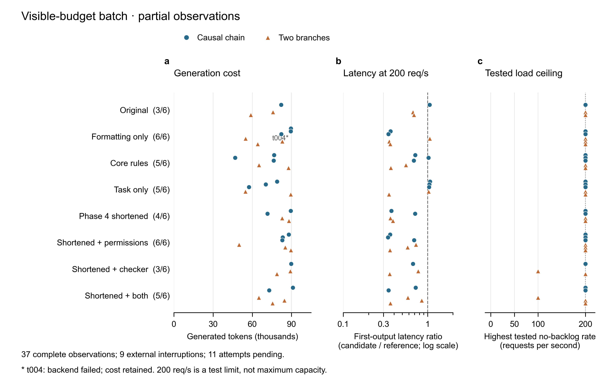

# 已完成轮次的成本与最终性能

图中每个点是一轮完整模型观察，圆点为串行因果卷积任务，三角为双分支任务。同一轮在三幅图中的纵向位置一致。左侧括号是已完成数/目标数；条件顺序按实验设计排列。原文、仅排版、主要规则、仅任务及Phase 4缩短说明的定义见[批次说明](../../../REPEAT_BATCH.zh.md)。八个条件尚未全部收齐，不作条件排名或显著性判断。

左图包含37轮的全部生成量，其中包括思考和答案，不包含输入上下文，因而它不是总费用图。t004后端失败，消耗仍计入。其余两图保留最终独立数值验证通过且保护源码未改变的36轮。中图取200请求/秒档位首块延迟中位数，除以同次先测的参考后端数值；虚线为相等，小于1表示候选首块较早。计时起点为输入实际交付，参考在该负载下可能积压，图中没有计入交付前的外部排队等待。

右图只按负载检查取最高通过档位：一秒有限窗口内，最终接纳延迟不超过一个提交周期、外部队列峰值不超过一个请求。它没有混入原有的总体输出间隔检查。36个有效后端中有34个通过了200请求/秒，这个数字是旧测试的上限，不能看成后端的真实最大吞吐。这个拥挤的右图说明，旧负载范围对多数候选的区分能力有限。自然工作阶段已提前固定更高负载档位；当前图没有据此补测旧候选。

全部57个尝试机会都列在[源数据](observations.csv)里，包含37轮完整观察、9次外部中断和11个未运行机会，逐行记录纳入情况、缺失原因及原结果校验值。原始记录见[归档索引](../../repeat-archive-index.json)。可编辑版本为[SVG](partial-comparison.svg)与[PDF](partial-comparison.pdf)，生成输入、脚本和各导出的校验值见[来源记录](provenance.json)。

绘图使用Python/matplotlib，183×116毫米；无抽样、无汇总柱、无误差线、无显著性检验。一个任务/条件下三轮是独立模型运行，不是GPU性能测量重复；本图不把它们解释为来自广泛任务总体的抽样。

检查记录：绘图源预检查13项通过、0项失败；唯一提示是没有TIFF，本次交付为矢量图及PNG预览，未要求TIFF。已查看实际PNG，三栏坐标、标签、点形和脚注可读。SVG保留文本节点，PDF嵌入TrueType字体；这些结构检查不替代对数据口径的审阅。
